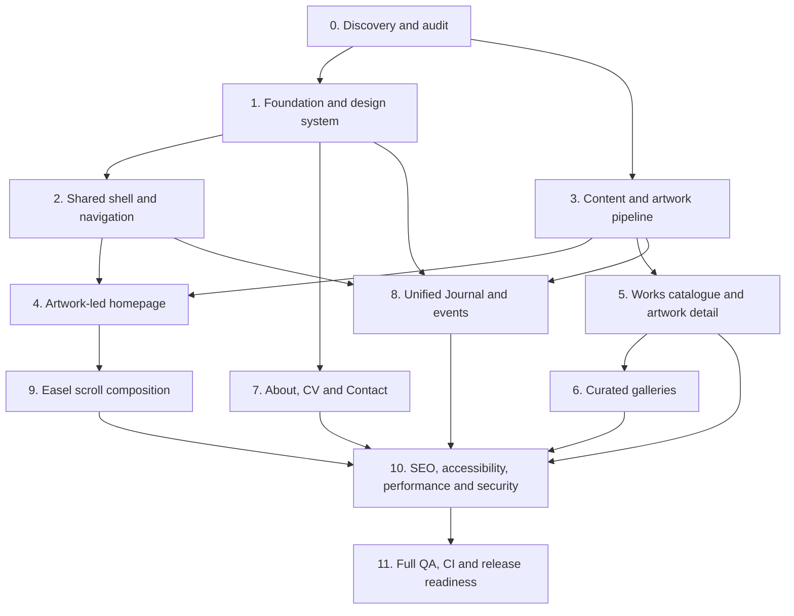

# Nasoodi.art — Phased Implementation Blueprint

**Status:** Proposed execution blueprint; phase completion must be evidenced  
**Working branch:** `feature`  
**Product:** Bilingual Persian/English portfolio for oil painter Ghazaleh Abdolahzade Nasoodi  
**Primary design direction:** “The artist's quiet gallery”  
**Companion execution prompt:** [website-implementation-prompt.md](./website-implementation-prompt.md)

This blueprint converts the product and design specifications into dependency-aware implementation phases. It is the execution sequence for implementation work. Page-specific specifications remain authoritative for detailed behavior and content; this blueprint governs sequencing, dependencies, exit gates, and evidence.

## Guiding principles

1. Finished, artist-approved paintings are the primary content; the interface frames them.
2. The homepage hero is an approved finished painting, not a studio/process photograph.
3. Do not invent artist facts, artwork metadata, gallery groupings, translations, rights, or approvals.
4. Preserve original artwork color, texture, aspect ratio, orientation, and signature.
5. Persian RTL and English LTR are first-class experiences; the physical-left sidebar stays left in both.
6. Apply the mandatory design-engineering and refined design-system authorities in every UI phase.
7. Build in small vertical slices; test and visually inspect real output before marking a phase complete.
8. Do not merge to `main`, deploy, publish, or alter branch strategy without separate explicit authorization.

## Phase dependency map

Phases may proceed in parallel only where dependencies are satisfied and changes do not conflict. Phase 0 is mandatory before implementation. Content-dependent public features may be built with unpublished fixtures, but must not expose unapproved content.

## Phase 0 — Repository, product, content, and asset discovery

**Objective:** Establish an evidence-based implementation baseline and resolve critical unknowns before design or code decisions.

**Work**
- Inspect branch, HEAD, worktree, routes, layouts, components, tokens, dependencies, scripts, tests, workflows, and hosting configuration.
- Read all mandatory specifications and reconcile conflicts, especially the homepage hero direction and the unified Journal information architecture.
- Inventory all image assets. Inspect actual visual content, dimensions, orientation, color profile, file size, source/provenance, rights, approval, and derivative status.
- Inspect `specification/assets/artwork.JPG` and every file in `specification/assets/gallery/`; filenames alone do not establish grouping or suitability.
- Create an asset manifest linking source master, canonical content ID, intended use, approval state, and derivative paths.
- Confirm artist identity spelling, locale priorities, hero painting, selected works, gallery names/membership/order/covers, artwork metadata, biography/statement, CV, exhibitions, Journal entries, event facts, contact route, and any sales/commission scope.
- Record all missing facts and approval dependencies.

**Deliverables**
- Repository baseline and gap report.
- Asset manifest and source/rights/approval register.
- Content readiness matrix and explicit owner questions.
- Reconciled list of routes, requirements, and implementation gaps.

**Tests / verification**
- Verify actual asset metadata and open images for visual inspection.
- Validate that content records can distinguish draft, approved, and published states.
- Confirm current build/test commands and existing CI workflows.

**Exit gate**
- No critical implementation decision relies on guessed repository structure or invented content.
- Every candidate public asset has a documented status.
- All unresolved content and approval decisions are recorded.

**Dependencies:** Owner/artist input for approval-dependent decisions.

## Phase 1 — Application foundation and design system

**Objective:** Establish a stable, reusable, accessible technical and visual foundation.

**Work**
- Preserve the current Next.js App Router, React, TypeScript, and Tailwind architecture unless inspection demonstrates a justified change.
- Remove starter-template identity and generic placeholder copy where safe.
- Establish semantic warm-paper, surface, ink, muted-text, accent, border, and focus tokens based on the visual identity specification.
- Implement a deliberate bilingual typography system after font license, Persian shaping, Latin rendering, weight, and file-size checks.
- Establish spacing, container, grid, image-frame, responsive, focus, and interaction-state conventions.
- Define strict content/data contracts for artist, localized content, artwork, galleries, Journal entries/events, assets, and CV entries.
- Add validation and publication gates so unapproved or incomplete content cannot be published.
- Establish baseline lint, typecheck, unit-test, and build checks.

**Deliverables**
- Documented tokens and typography decisions.
- Reusable primitives and validated content schemas.
- Baseline quality scripts and CI integration plan.

**Tests / verification**
- Token and schema tests.
- Persian/English rendering and direction tests.
- Typecheck, lint, build, and responsive foundation smoke tests.

**Exit gate**
- No parallel or conflicting design token system.
- Invalid/unapproved content is rejected or remains unpublished.
- Foundation is usable in both locales and keyboard/touch contexts.

## Phase 2 — Shared site shell and navigation

**Objective:** Deliver consistent navigation and layout behavior across all routes.

**Work**
- Implement desktop persistent physical-left sidebar.
- Implement accessible mobile off-canvas sidebar with locale/theme controls at the bottom where specified.
- Keep physical-left placement in both RTL and LTR; adapt reading direction and alignment without mirroring navigation placement.
- Add top-bar utilities only as confirmed by the navigation contract.
- Include Home, Works, Galleries, Journal, About, CV (if approved/appropriate), and Contact according to the final approved information architecture.
- Use one unified Journal route; do not create a separate Events top-level item.
- Implement focus management, Escape dismissal, focus restoration, active route semantics, touch targets, and clear open/close states.
- Implement locale switching and correct document-level `lang` and `dir`.

**Deliverables**
- Shared responsive shell and navigation components.
- Route/locale navigation configuration.
- Keyboard and touch interaction behavior.

**Tests / verification**
- Unit/component tests for active routes, drawer state, focus, Escape, locale switch, and RTL/LTR.
- Desktop/tablet/mobile/short-height screenshots.
- Keyboard-only and touch review.

**Exit gate**
- Navigation is consistent across routes, accessible, and correctly localized.
- No duplicate or unsupported navigation destinations.

## Phase 3 — Content model and artwork asset pipeline

**Objective:** Safely represent and deliver real paintings without compromising fidelity.

**Work**
- Implement canonical artwork records with stable IDs/slugs, localized approved titles/captions, metadata, source asset, publication state, alt text, and relationships.
- Implement gallery membership references without duplicating artwork records.
- Build a reproducible responsive derivative pipeline from approved masters.
- Preserve native ratio/orientation/color/texture/signature; do not crop unless a separately approved crop asset exists.
- Record dimensions, formats, quality settings, and source-to-derivative mapping.
- Define image loading priority, responsive sizes, intrinsic dimensions, and fallback behavior.
- Keep studio/process photos separately classified from finished artwork.

**Deliverables**
- Validated content schemas and sample fixtures.
- Asset manifest and derivative generation process.
- Approved image delivery components/utilities.

**Tests / verification**
- Schema and publication-gate tests.
- Image dimension/ratio/metadata tests.
- Source-to-derivative visual comparison and color/fidelity inspection.
- Missing image, unusual ratio, and loading/error-state tests.

**Exit gate**
- Every public artwork maps to an approved master and approved metadata.
- Derivatives preserve fidelity and no process image is misclassified as artwork.

## Phase 4 — Artwork-led homepage

**Objective:** Create a memorable, painting-first introduction to the artist.

**Work**
- Use one artist-approved finished painting as the dominant hero; `specification/assets/artwork.JPG` is only a candidate until inspected and approved.
- Establish artist identity and a concise approved introduction without invented biography or claims.
- Provide a clear Works path and meaningful exploration actions.
- Add a Featured Works section with deterministic selection of 3–6 approved artwork IDs where enough content exists.
- Add a separate Featured Galleries section with 2–4 published curated galleries where available.
- Add Latest from the Journal after artwork and gallery features; omit when no approved published entries exist.
- Keep the hierarchy editorial and artwork-led, not a repetitive card grid.
- Ensure each feature links to a valid canonical destination.

**Deliverables**
- Responsive homepage with approved content selection logic.
- Homepage metadata and structured data where factual support exists.

**Tests / verification**
- Homepage content-selection and link tests.
- Desktop/tablet/mobile/short-height visual QA in Persian and English.
- Artwork fidelity and no-crop checks.
- Empty/one/many works, no galleries, and no Journal content states.

**Exit gate**
- Hero and public copy are approved.
- Featured items are valid, approved records.
- Homepage hierarchy and responsive behavior pass visual review.

## Phase 5 — Works catalogue and artwork detail

**Objective:** Make the complete approved body of work discoverable and inspectable.

**Work**
- Implement Works index and stable artwork detail routes.
- Support optional meaningful groupings/series only when approved.
- Display approved artwork images uncropped with subordinate, verified metadata.
- Add accessible image viewing/zoom only if it improves inspection without compromising keyboard, touch, and reduced-motion behavior.
- Implement related gallery links and related artwork only when relationships are approved.
- Handle missing optional metadata without empty labels or invented values.

**Deliverables**
- Works catalogue, artwork detail template, route generation, and not-found behavior.

**Tests / verification**
- Route, slug uniqueness, schema, publication, metadata, alt-text, and sitemap tests.
- Keyboard/touch viewer tests if applicable.
- Persian/English visual inspection and image fidelity review.

**Exit gate**
- Every published work is artist-approved and traceable to a master.
- No fabricated metadata or broken routes.
- Catalogue remains usable with one, many, or no published works.

## Phase 6 — Multiple curated galleries

**Objective:** Present artist-approved curated collections as distinct editorial destinations.

**Work**
- Implement Galleries index and dedicated gallery detail routes.
- Support multiple independently titled/described galleries with ordered artwork membership and approved cover artwork.
- Allow one artwork to appear in multiple galleries using canonical artwork references.
- Validate unique slugs, non-empty published galleries, cover membership, localized fields, rights, and approval states.
- Provide clear navigation between gallery, artwork, and other relevant galleries without duplicating records.

**Deliverables**
- Gallery schemas, index, detail pages, and editorial validation.

**Tests / verification**
- Gallery membership/order/cover/slug tests.
- Route, SEO, sitemap, accessibility, and responsive tests.
- Screenshots of index and at least two distinct detail pages when two approved galleries exist.

**Exit gate**
- Every published gallery has artist-approved name, description, cover, and membership.
- Cross-gallery artwork references remain canonical and consistent.

## Phase 7 — About, CV, and Contact

**Objective:** Provide accurate artist context and a reliable contact path.

**Work**
- Implement About with approved artist statement and factual biography as separate content fields.
- Implement CV/Exhibitions only when verified entries exist; omit empty or fabricated sections.
- Implement Contact with an explicitly approved public channel.
- Add a contact form only if delivery infrastructure, validation, spam protection, accessibility, privacy handling, and failure states are implemented and approved.
- Add artwork enquiry context only when the owner approves the workflow.

**Deliverables**
- About, CV/Exhibitions, and Contact routes as supported by approved content.
- Validated contact behavior or a direct approved contact link.

**Tests / verification**
- Content approval and localization review.
- Contact destination and delivery tests if a form exists.
- Privacy/security review and responsive/keyboard checks.

**Exit gate**
- No unverified CV or biography claims.
- Contact route is real, public, tested, and approved.

## Phase 8 — Unified Journal and events

**Objective:** Provide one editorial destination for articles and event announcements.

**Work**
- Implement Journal archive and detail routes with validated entry types (article and event) and publication states.
- Include type filters only where useful and accessible.
- Add event date/time, timezone, venue, attendance mode, registration destination, and temporal status only from verified facts.
- Keep event occurrence status distinct from editorial publication status.
- Link related artwork/galleries using canonical records.
- Add homepage latest Journal section and optional upcoming-event feature when approved eligible content exists.
- Do not add a separate Events top-level navigation item.

**Deliverables**
- Journal archive, article/event templates, filters, content validation, and homepage integration.

**Tests / verification**
- Publication visibility, event time-zone, temporal state, and filter tests.
- Article/Event structured data only when content qualifies.
- Route, sitemap, metadata, accessibility, responsive, and bilingual visual tests.

**Exit gate**
- Journal and event content is approved and accurate.
- Draft/unapproved content is never publicly exposed.
- Empty and no-upcoming-event states are intentional.

## Phase 9 — Easel scroll background

**Objective:** Add the specified subtle studio/easel motif without competing with artwork or content.

**Work**
- Follow `easel-scroll-background.md` exactly.
- Use the approved source assets and document-relative composition.
- Implement subtle, reversible scroll-linked reveal only if it remains performant and accessible.
- Keep the composition behind content and outside interactive hit areas.
- Reduce or hide it at constrained viewports as specified.
- Provide a static/no-motion fallback and honor `prefers-reduced-motion`.

**Deliverables**
- Easel background component and responsive/reduced-motion behavior.

**Tests / verification**
- Screenshot review at long/short pages and desktop/tablet/mobile.
- Reduced-motion, high zoom, contrast, and interaction-hit-testing.
- Mobile performance and scroll smoothness.

**Exit gate**
- Effect is subtle, reversible, non-blocking, and does not obscure or alter artwork.
- Full site remains usable with motion disabled.

## Phase 10 — SEO, accessibility, performance, privacy, and security

**Objective:** Make the complete site discoverable, inclusive, fast, and responsibly operated.

**Work**
- Implement factual localized metadata, canonical URLs, Persian/English alternates, sitemap, robots, Open Graph, and supported structured data.
- Validate route indexing and avoid indexing drafts or duplicate localized URLs.
- Audit WCAG 2.2 AA semantics, contrast, keyboard, focus, names, touch targets, zoom/reflow, reduced motion, and screen-reader behavior.
- Measure Core Web Vitals and optimize image delivery, fonts, hydration, scripts, and layout stability based on evidence.
- Minimize tracking and third-party requests; review CSP, headers, dependencies, form handling, and data collection.
- Do not make unsupported security or privacy claims.

**Deliverables**
- SEO implementation and validation report.
- Accessibility findings and remediation.
- Performance measurements and optimization record.
- Privacy/security review and risk register.

**Tests / verification**
- Metadata, canonical, hreflang, sitemap, robots, and JSON-LD validation.
- Automated accessibility tests plus manual keyboard/screen-reader checks.
- Production-like mobile performance and Core Web Vitals.
- Dependency/security checks and route smoke tests.

**Exit gate**
- No critical accessibility/security issues remain.
- SEO signals match real approved content.
- Performance is measured and acceptable on mobile.
- Privacy behavior is documented and minimal.

## Phase 11 — Full regression, CI, and release readiness

**Objective:** Verify the integrated product and prepare a safe handoff without publishing.

**Work**
- Test every public route and locale across desktop, tablet, mobile, and short-height viewports.
- Verify loading, empty, error, not-found, long-title, unusual-image-ratio, and optional-content states.
- Run all repository quality commands discovered in `package.json`, including lint, typecheck, unit/component/integration/E2E tests, and production build where available.
- Ensure GitHub Actions CI runs the relevant checks; inspect actual workflow logs and report the exact run conclusion.
- Capture and inspect screenshot evidence with manifests; fix issues and repeat screenshots.
- Verify external/social/contact links, metadata, sitemap/robots, image integrity, and no unintended third-party requests.
- Record release notes, known limitations, rollback considerations, and owner approvals outstanding.

**Deliverables**
- Test and CI evidence.
- Screenshot set and manifest.
- Accessibility, SEO, performance, and artwork-fidelity reports.
- Release-readiness checklist and handoff report.

**Exit gate**
- All relevant automated checks and production build pass.
- CI passes with actual logs inspected.
- Visual QA is complete for required routes/locales/viewports.
- Artist/site-owner approval is recorded for public content and visual choices.
- Merge, deployment, and publication remain separate actions requiring explicit authorization.

## Phase tracking template

Copy this block for every phase in the implementation report:

| Field | Required evidence |
|---|---|
| Status | Not started / In progress / Blocked / Complete |
| Scope | Requirements and paths addressed |
| Dependencies | Completed phases and owner decisions |
| Changes | Changed files and concise implementation summary |
| Tests | Exact commands, results, and relevant test counts |
| CI | Workflow, run URL, conclusion, and log evidence |
| Visual QA | Routes, locale, viewport, state, screenshot paths, findings |
| Approvals | Artist/site-owner decisions completed or outstanding |
| Risks | Known defects, limitations, and mitigations |
| Next step | Concrete next action and owner/dependency |

## Cross-phase quality gates

These apply to every phase, not only the final QA phase:

- Read the relevant design authorities and page-specific specifications before implementation.
- Inspect existing code/assets before creating new patterns.
- Preserve artwork and editorial integrity.
- Test Persian RTL and English LTR.
- Test keyboard, touch, focus, and reduced motion for affected interactions.
- Inspect actual rendered screenshots; source review alone is insufficient.
- Update the relevant specification when a durable design or behavior decision changes.
- Never report a phase complete without its exit evidence.

## Current status

All phases are **proposed / not verified as implemented** until the implementation agent inspects the repository and records evidence. This document is a plan, not a claim of completion.
