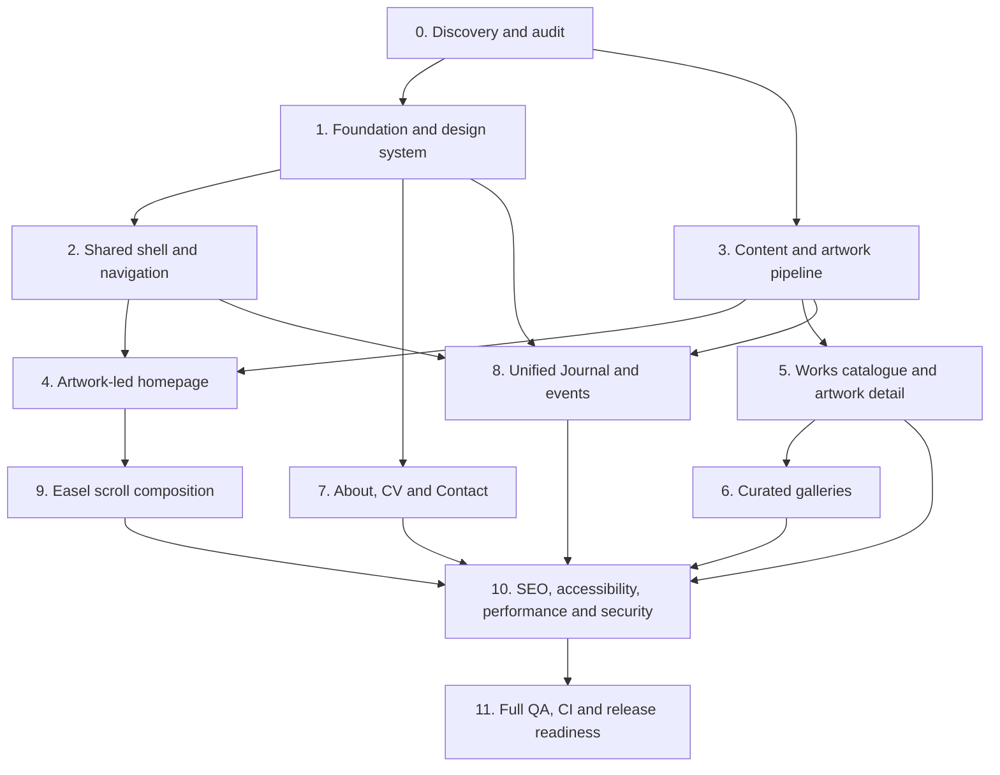

# Nasoodi.art — Phased Implementation Blueprint

**Status:** Proposed execution blueprint; phase completion must be evidenced  
**Working branch:** `feature`  
**Product:** Bilingual Persian/English portfolio for oil painter Ghazaleh Abdolahzade Nasoodi  
**Primary design direction:** “The artist's quiet gallery”  
**Companion execution prompt:** [website-implementation-prompt.md](./website-implementation-prompt.md)

This blueprint converts the product and design specifications into dependency-aware implementation phases. It is the execution sequence for implementation work. Page-specific specifications remain authoritative for detailed behavior and content; this blueprint governs sequencing, dependencies, exit gates, and evidence.

## Guiding principles

1. Finished, artist-approved paintings are the primary content; the interface frames them.
2. The homepage hero is an approved finished painting, not a studio/process photograph.
3. Do not invent artist facts, artwork metadata, gallery groupings, translations, rights, or approvals.
4. Preserve original artwork color, texture, aspect ratio, orientation, and signature.
5. Persian RTL and English LTR are first-class experiences; the physical-left sidebar stays left in both.
6. Apply the mandatory design-engineering and refined design-system authorities in every UI phase.
7. Build in small vertical slices; test and visually inspect real output before marking a phase complete.
8. Do not merge to `main`, deploy, publish, or alter branch strategy without separate explicit authorization.

## Phase dependency map

Phases may proceed in parallel only where dependencies are satisfied and changes do not conflict. Phase 0 is mandatory before implementation. Content-dependent public features may be built with unpublished fixtures, but must not expose unapproved content.

## Phase 0 — Repository, product, content, and asset discovery

**Objective:** Establish an evidence-based implementation baseline and resolve critical unknowns before design or code decisions.

**Work**
- Inspect branch, HEAD, worktree, routes, layouts, components, tokens, dependencies, scripts, tests, workflows, and hosting configuration.
- Read all mandatory specifications and reconcile conflicts, especially the homepage hero direction and the unified Journal information architecture.
- Inventory all image assets. Inspect actual visual content, dimensions, orientation, color profile, file size, source/provenance, rights, approval, and derivative status.
- Inspect `specification/assets/artwork.JPG` and every file in `specification/assets/gallery/`; filenames alone do not establish grouping or suitability.
- Create an asset manifest linking source master, canonical content ID, intended use, approval state, and derivative paths.
- Confirm artist identity spelling, locale priorities, hero painting, selected works, gallery names/membership/order/covers, artwork metadata, biography/statement, CV, exhibitions, Journal entries, event facts, contact route, and any sales/commission scope.
- Record all missing facts and approval dependencies.

**Deliverables**
- Repository baseline and gap report.
- Asset manifest and source/rights/approval register.
- Content readiness matrix and explicit owner questions.
- Reconciled list of routes, requirements, and implementation gaps.

**Tests / verification**
- Verify actual asset metadata and open images for visual inspection.
- Validate that content records can distinguish draft, approved, and published states.
- Confirm current build/test commands and existing CI workflows.

**Exit gate**
- No critical implementation decision relies on guessed repository structure or invented content.
- Every candidate public asset has a documented status.
- All unresolved content and approval decisions are recorded.

**Dependencies:** Owner/artist input for approval-dependent decisions.

## Phase 1 — Application foundation and design system

**Objective:** Establish a stable, reusable, accessible technical and visual foundation.

**Work**
- Preserve the current Next.js App Router, React, TypeScript, and Tailwind architecture unless inspection demonstrates a justified change.
- Remove starter-template identity and generic placeholder copy where safe.
- Establish semantic warm-paper, surface, ink, muted-text, accent, border, and focus tokens based on the visual identity specification.
- Implement a deliberate bilingual typography system after font license, Persian shaping, Latin rendering, weight, and file-size checks.
- Establish spacing, container, grid, image-frame, responsive, focus, and interaction-state conventions.
- Define strict content/data contracts for artist, localized content, artwork, galleries, Journal entries/events, assets, and CV entries.
- Add validation and publication gates so unapproved or incomplete content cannot be published.
- Establish baseline lint, typecheck, unit-test, and build checks.

**Deliverables**
- Documented tokens and typography decisions.
- Reusable primitives and validated content schemas.
- Baseline quality scripts and CI integration plan.

**Tests / verification**
- Token and schema tests.
- Persian/English rendering and direction tests.
- Typecheck, lint, build, and responsive foundation smoke tests.

**Exit gate**
- No parallel or conflicting design token system.
- Invalid/unapproved content is rejected or remains unpublished.
- Foundation is usable in both locales and keyboard/touch contexts.

## Phase 2 — Shared site shell and navigation

**Objective:** Deliver consistent navigation and layout behavior across all routes.

**Work**
- Implement desktop persistent physical-left sidebar.
- Implement accessible mobile off-canvas sidebar with locale/theme controls at the bottom where specified.
- Keep physical-left placement in both RTL and LTR; adapt reading direction and alignment without mirroring navigation placement.
- Add top-bar utilities only as confirmed by the navigation contract.
- Include Home, Works, Galleries, Journal, About, CV (if approved/appropriate), and Contact according to the final approved information architecture.
- Use one unified Journal route; do not create a separate Events top-level item.
- Implement focus management, Escape dismissal, focus restoration, active route semantics, touch targets, and clear open/close states.
- Implement locale switching and correct document-level `lang` and `dir`.

**Deliverables**
- Shared responsive shell and navigation components.
- Route/locale navigation configuration.
- Keyboard and touch interaction behavior.

**Tests / verification**
- Unit/component tests for active routes, drawer state, focus, Escape, locale switch, and RTL/LTR.
- Desktop/tablet/mobile/short-height screenshots.
- Keyboard-only and touch review.

**Exit gate**
- Navigation is consistent across routes, accessible, and correctly localized.
- No duplicate or unsupported navigation destinations.

## Phase 3 — Content model and artwork asset pipeline

**Objective:** Safely represent and deliver real paintings without compromising fidelity.

**Work**
- Implement canonical artwork records with stable IDs/slugs, localized approved titles/captions, metadata, source asset, publication state, alt text, and relationships.
- Implement gallery membership references without duplicating artwork records.
- Build a reproducible responsive derivative pipeline from approved masters.
- Preserve native ratio/orientation/color/texture/signature; do not crop unless a separately approved crop asset exists.
- Record dimensions, formats, quality settings, and source-to-derivative mapping.
- Define image loading priority, responsive sizes, intrinsic dimensions, and fallback behavior.
- Keep studio/process photos separately classified from finished artwork.

**Deliverables**
- Validated content schemas and sample fixtures.
- Asset manifest and derivative generation process.
- Approved image delivery components/utilities.

**Tests / verification**
- Schema and publication-gate tests.
- Image dimension/ratio/metadata tests.
- Source-to-derivative visual comparison and color/fidelity inspection.
- Missing image, unusual ratio, and loading/error-state tests.

**Exit gate**
- Every public artwork maps to an approved master and approved metadata.
- Derivatives preserve fidelity and no process image is misclassified as artwork.

## Phase 4 — Artwork-led homepage

**Objective:** Create a memorable, painting-first introduction to the artist.

**Work**
- Use one artist-approved finished painting as the dominant hero; `specification/assets/artwork.JPG` is only a candidate until inspected and approved.
- Establish artist identity and a concise approved introduction without invented biography or claims.
- Provide a clear Works path and meaningful exploration actions.
- Add a Featured Works section with deterministic selection of 3–6 approved artwork IDs where enough content exists.
- Add a separate Featured Galleries section with 2–4 published curated galleries where available.
- Add Latest from the Journal after artwork and gallery features; omit when no approved published entries exist.
- Keep the hierarchy editorial and artwork-led, not a repetitive card grid.
- Ensure each feature links to a valid canonical destination.

**Deliverables**
- Responsive homepage with approved content selection logic.
- Homepage metadata and structured data where factual support exists.

**Tests / verification**
- Homepage content-selection and link tests.
- Desktop/tablet/mobile/short-height visual QA in Persian and English.
- Artwork fidelity and no-crop checks.
- Empty/one/many works, no galleries, and no Journal content states.

**Exit gate**
- Hero and public copy are approved.
- Featured items are valid, approved records.
- Homepage hierarchy and responsive behavior pass visual review.

## Phase 5 — Works catalogue and artwork detail

**Objective:** Make the complete approved body of work discoverable and inspectable.

**Work**
- Implement Works index and stable artwork detail routes.
- Support optional meaningful groupings/series only when approved.
- Display approved artwork images uncropped with subordinate, verified metadata.
- Add accessible image viewing/zoom only if it improves inspection without compromising keyboard, touch, and reduced-motion behavior.
- Implement related gallery links and related artwork only when relationships are approved.
- Handle missing optional metadata without empty labels or invented values.

**Deliverables**
- Works catalogue, artwork detail template, route generation, and not-found behavior.

**Tests / verification**
- Route, slug uniqueness, schema, publication, metadata, alt-text, and sitemap tests.
- Keyboard/touch viewer tests if applicable.
- Persian/English visual inspection and image fidelity review.

**Exit gate**
- Every published work is artist-approved and traceable to a master.
- No fabricated metadata or broken routes.
- Catalogue remains usable with one, many, or no published works.

## Phase 6 — Multiple curated galleries

**Objective:** Present artist-approved curated collections as distinct editorial destinations.

**Work**
- Implement Galleries index and dedicated gallery detail routes.
- Support multiple independently titled/described galleries with ordered artwork membership and approved cover artwork.
- Allow one artwork to appear in multiple galleries using canonical artwork references.
- Validate unique slugs, non-empty published galleries, cover membership, localized fields, rights, and approval states.
- Provide clear navigation between gallery, artwork, and other relevant galleries without duplicating records.

**Deliverables**
- Gallery schemas, index, detail pages, and editorial validation.

**Tests / verification**
- Gallery membership/order/cover/slug tests.
- Route, SEO, sitemap, accessibility, and responsive tests.
- Screenshots of index and at least two distinct detail pages when two approved galleries exist.

**Exit gate**
- Every published gallery has artist-approved name, description, cover, and membership.
- Cross-gallery artwork references remain canonical and consistent.

## Phase 7 — About, CV, and Contact

**Objective:** Provide accurate artist context and a reliable contact path.

**Work**
- Implement About with approved artist statement and factual biography as separate content fields.
- Implement CV/Exhibitions only when verified entries exist; omit empty or fabricated sections.
- Implement Contact with an explicitly approved public channel.
- Add a contact form only if delivery infrastructure, validation, spam protection, accessibility, privacy handling, and failure states are implemented and approved.
- Add artwork enquiry context only when the owner approves the workflow.

**Deliverables**
- About, CV/Exhibitions, and Contact routes as supported by approved content.
- Validated contact behavior or a direct approved contact link.

**Tests / verification**
- Content approval and localization review.
- Contact destination and delivery tests if a form exists.
- Privacy/security review and responsive/keyboard checks.

**Exit gate**
- No unverified CV or biography claims.
- Contact route is real, public, tested, and approved.

## Phase 8 — Unified Journal and events

**Objective:** Provide one editorial destination for articles and event announcements.

**Work**
- Implement Journal archive and detail routes with validated entry types (article and event) and publication states.
- Include type filters only where useful and accessible.
- Add event date/time, timezone, venue, attendance mode, registration destination, and temporal status only from verified facts.
- Keep event occurrence status distinct from editorial publication status.
- Link related artwork/galleries using canonical records.
- Add homepage latest Journal section and optional upcoming-event feature when approved eligible content exists.
- Do not add a separate Events top-level navigation item.

**Deliverables**
- Journal archive, article/event templates, filters, content validation, and homepage integration.

**Tests / verification**
- Publication visibility, event time-zone, temporal state, and filter tests.
- Article/Event structured data only when content qualifies.
- Route, sitemap, metadata, accessibility, responsive, and bilingual visual tests.

**Exit gate**
- Journal and event content is approved and accurate.
- Draft/unapproved content is never publicly exposed.
- Empty and no-upcoming-event states are intentional.

## Phase 9 — Easel scroll background

**Objective:** Add the specified subtle studio/easel motif without competing with artwork or content.

**Work**
- Follow `easel-scroll-background.md` exactly.
- Use the approved source assets and document-relative composition.
- Implement subtle, reversible scroll-linked reveal only if it remains performant and accessible.
- Keep the composition behind content and outside interactive hit areas.
- Reduce or hide it at constrained viewports as specified.
- Provide a static/no-motion fallback and honor `prefers-reduced-motion`.

**Deliverables**
- Easel background component and responsive/reduced-motion behavior.

**Tests / verification**
- Screenshot review at long/short pages and desktop/tablet/mobile.
- Reduced-motion, high zoom, contrast, and interaction-hit-testing.
- Mobile performance and scroll smoothness.

**Exit gate**
- Effect is subtle, reversible, non-blocking, and does not obscure or alter artwork.
- Full site remains usable with motion disabled.

## Phase 10 — SEO, accessibility, performance, privacy, and security

**Objective:** Make the complete site discoverable, inclusive, fast, and responsibly operated.

**Work**
- Implement factual localized metadata, canonical URLs, Persian/English alternates, sitemap, robots, Open Graph, and supported structured data.
- Validate route indexing and avoid indexing drafts or duplicate localized URLs.
- Audit WCAG 2.2 AA semantics, contrast, keyboard, focus, names, touch targets, zoom/reflow, reduced motion, and screen-reader behavior.
- Measure Core Web Vitals and optimize image delivery, fonts, hydration, scripts, and layout stability based on evidence.
- Minimize tracking and third-party requests; review CSP, headers, dependencies, form handling, and data collection.
- Do not make unsupported security or privacy claims.

**Deliverables**
- SEO implementation and validation report.
- Accessibility findings and remediation.
- Performance measurements and optimization record.
- Privacy/security review and risk register.

**Tests / verification**
- Metadata, canonical, hreflang, sitemap, robots, and JSON-LD validation.
- Automated accessibility tests plus manual keyboard/screen-reader checks.
- Production-like mobile performance and Core Web Vitals.
- Dependency/security checks and route smoke tests.

**Exit gate**
- No critical accessibility/security issues remain.
- SEO signals match real approved content.
- Performance is measured and acceptable on mobile.
- Privacy behavior is documented and minimal.

## Phase 11 — Full regression, CI, and release readiness

**Objective:** Verify the integrated product and prepare a safe handoff without publishing.

**Work**
- Test every public route and locale across desktop, tablet, mobile, and short-height viewports.
- Verify loading, empty, error, not-found, long-title, unusual-image-ratio, and optional-content states.
- Run all repository quality commands discovered in `package.json`, including lint, typecheck, unit/component/integration/E2E tests, and production build where available.
- Ensure GitHub Actions CI runs the relevant checks; inspect actual workflow logs and report the exact run conclusion.
- Capture and inspect screenshot evidence with manifests; fix issues and repeat screenshots.
- Verify external/social/contact links, metadata, sitemap/robots, image integrity, and no unintended third-party requests.
- Record release notes, known limitations, rollback considerations, and owner approvals outstanding.

**Deliverables**
- Test and CI evidence.
- Screenshot set and manifest.
- Accessibility, SEO, performance, and artwork-fidelity reports.
- Release-readiness checklist and handoff report.

**Exit gate**
- All relevant automated checks and production build pass.
- CI passes with actual logs inspected.
- Visual QA is complete for required routes/locales/viewports.
- Artist/site-owner approval is recorded for public content and visual choices.
- Merge, deployment, and publication remain separate actions requiring explicit authorization.

## Phase tracking template

Copy this block for every phase in the implementation report:

| Field | Required evidence |
|---|---|
| Status | Not started / In progress / Blocked / Complete |
| Scope | Requirements and paths addressed |
| Dependencies | Completed phases and owner decisions |
| Changes | Changed files and concise implementation summary |
| Tests | Exact commands, results, and relevant test counts |
| CI | Workflow, run URL, conclusion, and log evidence |
| Visual QA | Routes, locale, viewport, state, screenshot paths, findings |
| Approvals | Artist/site-owner decisions completed or outstanding |
| Risks | Known defects, limitations, and mitigations |
| Next step | Concrete next action and owner/dependency |

## Cross-phase quality gates

These apply to every phase, not only the final QA phase:

- Read the relevant design authorities and page-specific specifications before implementation.
- Inspect existing code/assets before creating new patterns.
- Preserve artwork and editorial integrity.
- Test Persian RTL and English LTR.
- Test keyboard, touch, focus, and reduced motion for affected interactions.
- Inspect actual rendered screenshots; source review alone is insufficient.
- Update the relevant specification when a durable design or behavior decision changes.
- Never report a phase complete without its exit evidence.

## Implementation progress — 2026-10-30

This is an evidence snapshot, not a declaration that every blueprint phase is complete.

| Phase | Status | Evidence and remaining gates |
|---|---|---|
| 0. Repository and asset discovery | In progress | Repository structure, scripts, CI, route baseline, and supplied transparent artist/easel cutouts inspected. Finished-painting assets, rights, metadata, translations, and public-use approvals remain unverified. See [asset review register](./asset-review-register.md). |
| 1. Application foundation and design system | Implemented; CI verified | Next.js route-group foundation, semantic warm-paper palette, strict TypeScript content contracts, root redirect, and responsive page frame. Exact Latin/Persian font pairing remains a licensing/rendering decision. |
| 2. Shared shell and navigation | Implemented; browser QA verified | Physical-left desktop sidebar, locale utility, mobile off-canvas drawer, keyboard Escape/focus restoration, and Persian/English direction. Playwright checks cover drawer behavior and physical-left positioning. Theme selector remains unresolved because the navigation spec requests Light/Dark/System while the refined design authority says not to infer dark-mode scope without confirmation. |
| 3. Content model and asset pipeline | Partial | Artwork, Gallery, Journal types and publication filters exist; collections are deliberately empty. Asset register, source/rights approval, derivative generation, and visual comparison remain outstanding. |
| 4. Artwork-led homepage | Partial / content blocked | Localized homepage composition, featured Works/Galleries/Journal sections and honest empty states exist. The required approved finished-painting hero is not published because no specific hero asset approval is recorded. |
| 5. Works and artwork detail | Partial | Localized catalogue/detail route templates, metadata omission, and 404 behavior exist. No artwork records are published. |
| 6. Curated galleries | Partial | Gallery index/detail route templates and canonical artwork references exist. No gallery names, covers, descriptions, or memberships are published without approval. |
| 7. About, CV, and Contact | Partial / content blocked | About and Contact routes disclose missing approved copy/contact details. CV is omitted because no verified entries are available. |
| 8. Unified Journal and events | Partial | One Journal route supports article/event records; no entries are published. No separate Events navigation destination is added. |
| 9. Easel scroll background | Not started | Source easel cutout inspected; full-page sizing, document-relative mapping, responsive/reduced-motion behavior, and explicit public-use approval gate remain. |
| 10. SEO, accessibility, performance, privacy, and security | Partial | Locale metadata, canonical homepage alternates, robots, sitemap, semantic landmarks, focus styling, reduced-motion CSS, and route noindex rules for empty editorial destinations exist. Manual WCAG 2.2 AA, screen-reader, performance, security, and privacy audits remain. |
| 11. Regression, CI, and release readiness | In progress | ESLint, TypeScript, four content-publication tests, production build, seven Playwright browser tests, screenshot artifact upload, and production route smoke tests passed on commit `5b1ad749cfff1b568cf24c5226aa47cfbcd5d508`. Visual screenshots were inspected at desktop and mobile sizes; artist/content approvals remain outstanding. |

### Verified implementation evidence

- Repository: `mrcode-tech/nasoodi.art`
- Active branch: `feature`
- Verified commit: `5b1ad749cfff1b568cf24c5226aa47cfbcd5d508`
- Successful GitHub Actions run: [41057600503](https://github.com/mrcode-tech/nasoodi.art/actions/runs/41057600503)
- Browser tests: 7 passed, 0 failed.
- Content publication tests: 4 passed, 0 failed.
- Visual QA artifact: `nasoodi-visual-qa-5b1ad749cfff1b568cf24c5226aa47cfbcd5d508` (artifact ID `12977058389`).
- Inspected screenshots: Persian desktop homepage (1440 × 960), Persian mobile menu (390 × 844), and English mobile menu (390 × 844).

The screenshots verify shell/layout and responsive menu behavior, not final artwork-led visual acceptance. The homepage remains intentionally sparse because approved painting records and hero image selection are not yet available.

### Explicit publication blockers

1. Confirm which supplied files are finished-painting masters and which are process/composite assets.
2. Approve the exact homepage hero painting and public use of each image.
3. Confirm artwork titles or approved untitled treatment, alt text, metadata, order, and gallery membership.
4. Approve Persian and English artist statement, biography, translations, public contact channel, and any CV/Journal facts.
5. Resolve whether the Light/Dark/System selector remains a product requirement.
6. Approve the easel asset's site-wide decorative use and final scroll treatment.

Until those decisions are recorded, keep the related content unpublished and non-indexable. Do not substitute invented or generated artwork.

## Incremental implementation update — 2026-10-30

This update records verified code and CI work after the earlier evidence snapshot. It does not mark the overall website or any phase as release-complete.

| Phase | Updated status | New implementation evidence | Remaining gate |
|---|---|---|---|
| 3. Content model and artwork asset pipeline | Partial | Journal entries now use the specification's four discriminants (`exhibition`, `event`, `studio-update`, `story`), constrained rich-text blocks (paragraphs, headings, lists, quotes, safe links), explicit artist approval, per-locale approval, and scheduled publication state. Unsafe rich-text link schemes are rejected. | Approved content records, source-to-derivative pipeline, rights evidence, and painting fidelity review remain outstanding. |
| 6. Multiple curated galleries | Partial | Homepage and Galleries index now resolve each gallery's canonical cover artwork through the public-artwork gate and display its approved image, localized title, and description. Cover imagery is rendered without cropping. | No gallery content is published until cover, title, description, membership, translations, and rights are approved. |
| 8. Unified Journal and events | Partial | Added URL-addressable filters for Exhibitions, Events, Studio Updates, and Stories; localized labels; active filter semantics; empty-category feedback; publication/event dates; event time-zone validation; and constrained rich-text detail rendering. | No Journal or event records are published; actual event facts, copy, dates, and translations require approval. |
| 10. SEO, accessibility, performance, privacy, and security | Partial | Added localized canonical/Open Graph metadata for artwork, gallery, and Journal details. Filtered Journal URLs canonicalize to the archive, and empty editorial destinations remain noindex. | Structured data qualification, manual WCAG 2.2 AA/screen-reader audit, production-like Core Web Vitals, and privacy/security review remain. |
| 11. Regression, CI, and release readiness | In progress | GitHub Actions run [41060637606](https://github.com/mrcode-tech/nasoodi.art/actions/runs/41060637606) passed on commit `82a32f0c1d8968ddb029930546c5d0aee32bd7a3`: ESLint, TypeScript, 11 content tests, production build, 8 Chromium browser tests, screenshot artifact upload, and production route smoke test. Screenshot artifact: `nasoodi-visual-qa-82a32f0c1d8968ddb029930546c5d0aee32bd7a3` (artifact ID `12979170943`). | Existing screenshots validate the tested shell and empty-content states, not final artwork-led visual acceptance. Firefox/Safari, real-device, assistive-technology, and manual visual audits remain. |

### Recent implementation commits

- `9752da1fb78f9ab3e8d4ae8ea934c6391f97f255` — categorized and filterable Journal archive.
- `d9e252d183088e810d1e0488185a540b793b3aa3` — canonical gallery cover artwork in discovery views.
- `6be70e8b91e57f74f9b5fb97d65eca1a28d116ee` — category test import correction; the subsequent complete successful verification is recorded above.
- `0c05ec094b93f790b9756329722bf41062291f47` — localized metadata for artwork, gallery, and Journal details.
- `e17a00a1ad623c899d5bb958f13e765be1199f74` — Journal type union aligned with the four specification categories.
- `373c2cc20065982954a213ed830f13180bb4fc8d` — constrained Journal rich-text rendering and safe link validation.
- `adcb576e6ad4cb000578e257bc14d4c65a1772c5` — completed Journal type-union migration.
- `85bcd3b3609dc817b392aa282933ef5f39d75989` — explicit Journal artist/locale publication approval gates.
- `82a32f0c1d8968ddb029930546c5d0aee32bd7a3` — canonical archive metadata and browser regression test.

### Publication and release blockers remain unchanged

The implementation intentionally does not invent paintings, artwork metadata, gallery memberships, artist biography/statement, CV entries, Journal copy, event facts, or public contact details. The approved homepage hero and public-use status of each painting remain owner decisions. The easel background remains unimplemented pending the specified asset-use approval and visual review. The Light/Dark/System selector remains unresolved against the conflicting design authorities.

Keep all unapproved content unpublished and non-indexable. No merge, deployment, or public release is authorized by this progress update.

## Incremental implementation update — 2026-10-30 (localization and event correctness)

This update records code and CI evidence from the latest feature-branch work. It does not mark the full site or release as complete.

| Area | Change | Evidence | Remaining gate |
|---|---|---|---|
| Localization | The locale switcher now checks whether the equivalent published Works, Gallery, Journal, or CV destination exists in the target locale. If not, it falls back to that locale's homepage. Static About and Contact routes retain their localized equivalents. | Unit coverage for the route resolver; updated Playwright test for the empty Works fallback. | Add translated records only after artist/editorial approval; verify reciprocal hreflang as content is approved. |
| Journal events | Event start/end timestamps now require an explicit ISO 8601 UTC offset or `Z`, plus the validated IANA time zone. Time-zone-less values are rejected to avoid server/visitor interpretation drift. | Content publication tests cover explicit offsets, UTC timestamps, invalid time zones, and timezone-less rejection. | Owner-supplied event records, dates, venues, and approved translations remain absent. |
| CI / regression | The full GitHub Actions pipeline passed after correcting the E2E expectation to match the specified locale-home fallback. | [Run 41065984109](https://github.com/mrcode-tech/nasoodi.art/actions/runs/41065984109): ESLint, TypeScript, content tests, production build, 11 Chromium E2E tests, screenshot artifact upload, and production route smoke test all passed. | Manual visual review, assistive-technology review, Firefox/Safari, and real-device QA remain. |

### Recent commits

- `b25b38a7b06fd3fa98fc4324d202060308de2238` — locale-aware equivalent-route fallback.
- `896571020802e00e0318c41a280d28a6b8be29a1` — explicit event timestamp validation and Journal contract update.
- `81dfab54d44a245645dc455311b1cd5ed251905a` — corrected locale fallback integration.
- `a8ac64d672873b1bc26a3e360e2569fc7f8ffab6` — corrected event timestamp validator syntax after CI lint caught the issue.
- `59c9cf042d126ea861999cec3f7945db4f2c6c1d` — E2E assertion aligned with the specified locale fallback.

The latest verified application commit is `59c9cf042d126ea861999cec3f7945db4f2c6c1d`. This progress record must be kept separate from artist approval and publication readiness.

## Incremental implementation update — 2026-10-30 (homepage event selection and event-local time)

This update records the next verified feature-branch increment. It does not mark the site or release as complete.

| Area | Change | Verification | Remaining gate |
|---|---|---|---|
| Homepage / Journal | Added a publication-gated upcoming-event selector. It chooses the nearest future event by its occurrence instant, requires the existing published/artist-approved/locale-approved event contract, and presents it as the lead item before up to two recent Journal entries. Expired events are not presented as upcoming. | Unit test covers chronological selection, expired-event exclusion, and locale approval. | No approved Journal/event records exist yet, so populated event rendering and editorial acceptance remain unverified. |
| Journal event dates | Archive event dates now format in the event's declared IANA time zone and show that zone; event details also show the zone and optional end time. Publication dates retain their separate UTC formatting. | ESLint, TypeScript, content tests, production build, 11 Chromium E2E tests, and production route smoke test passed together. | Verify populated event cards and detail pages in both locales when approved events are supplied. |
| CI / visual evidence | Successful GitHub Actions run [41068529735](https://github.com/mrcode-tech/nasoodi.art/actions/runs/41068529735) on commit `6e3e2b0718ac35683dcb662a872c0c397ff32569`. | 14 content tests passed; 11 Chromium E2E tests passed; lint, typecheck, build, screenshot upload, and smoke test passed. Visual QA artifact: `nasoodi-visual-qa-77c4b67d940cef33581b1bfdf23f0b4d8aa8bf41` (artifact ID `12984895625`). | Existing screenshots exercise empty-content and shell states; they cannot visually validate an event card until real approved event content is present. |

### Recent implementation commits

- `23ab175c8f559311c4a884a4d9eadaa55c0b01df` — upcoming Journal event selection and homepage presentation.
- `befa5415ad3635b99760b80148cacc825cf97f58` — Journal archive/detail event-local time-zone presentation.
- `6e3e2b0718ac35683dcb662a872c0c397ff32569` — corrected Journal event-card JSX and verified the complete CI pipeline.

The first CI attempt for the event-local time-zone presentation caught a JSX grouping error. That defect was corrected in the final commit above; the successful run is the evidence of the corrected state. The duplicate CI run triggered for the same commits is not needed to establish the passing result.

### Publication and release blockers

The approved homepage painting, published artwork/gallery records, CV facts, artist statement/biography, public contact destination, Journal entries/event facts, image rights, and easel-use approval remain owner/artist decisions. The Light/Dark/System selector remains unresolved against the conflicting design authorities. Do not fill these gaps with invented content or unapproved imagery. No merge, deployment, or publication is authorized by this progress update.

## Incremental implementation update — 2026-10-30 (latest feature work)

After the previous update, feature branch work added:
- A nearest-future, publication-gated Journal event preview on the homepage; expired events are excluded.
- Event date/time presentation in the declared IANA time zone on Journal archive and detail pages.
- Approval-gated artist profile and contact content models, About/Contact templates, localized metadata, sitemap gates, and noindex behavior while content is absent.
- VisualArtwork JSON-LD for artwork details and safe JSON-LD serialization.
- Journal Article/Event structured-data helpers with only confirmed localized facts, canonical URLs, explicit event instants, known attendance mode, and known venue.
- Additional Playwright coverage for accessibility landmarks, skip-link keyboard behavior, 320–1024 px overflow checks in both locales, and empty About/Contact sitemap/indexing rules.

Verification: GitHub Actions run 41070742829 passed 19 content tests and 15 Chromium E2E tests, plus lint, typecheck, production build, screenshot artifact upload, and production route smoke test on commit 98cef6e446d83688e42f6a5ec88bf49edac4a335. Commit 296d3ab56dba63c0408d287897037db7d19f6648 adds Journal Article/Event JSON-LD and tests; its CI run has not yet appeared in the branch workflow list at the time of this update.

Owner/artist gates remain: approved painting hero and artwork metadata/rights, approved profile copy/portrait, public contact destination, verified CV facts, Journal/event content and translations, easel-use approval, and the Light/Dark/System decision. No merge, deployment, or publication is authorized.

## Incremental implementation update — 2026-10-30 (Journal structured-data verification)

The Journal detail implementation now emits Article JSON-LD for editorial entries and Event JSON-LD for event entries. Event schema includes only confirmed start/end instants, a known attendance mode, and a localized venue when supplied; it does not synthesize offers, prices, addresses, or organizer data. The helper uses the repository's actual JournalEvent attendance-mode union and the shared safe JSON-LD serializer.

Verified on commit b3ced67771b582362998f186be68920ceb5fb450: [GitHub Actions run 41071561284](https://github.com/mrcode-tech/nasoodi.art/actions/runs/41071561284) passed ESLint, TypeScript, 21 content tests, production build, 15 Chromium E2E tests, screenshot artifact upload, and production route smoke test. Visual QA artifact: nasoodi-visual-qa-b3ced67771b582362998f186be68920ceb5fb450 (artifact ID 12986285020).

This validates the code paths and synthetic test records only. No real artwork, profile, CV, contact, Journal, or event content has been added or approved. Populated-page visual/SEO validation and all owner/artist publication gates remain outstanding.

## Incremental implementation update — 2026-10-30 (gallery discovery, security, navigation, and asset-path hardening)

This update supersedes earlier progress counts for the latest code state. It does not mark the site or release as complete.

| Area / phase | Implementation | Verification | Remaining gate |
|---|---|---|---|
| Gallery SEO (Phase 6/10) | Gallery detail routes now emit `CollectionPage` JSON-LD with an ordered `ItemList` of only locale-approved, published artwork members. Gallery covers provide Open Graph and Twitter large-image previews; artwork detail pages also provide Twitter previews when an approved primary image exists. | Collection schema helper test verifies curated order and exclusion of unpublished works. | Validate rendered previews and structured data with real artist-approved gallery content. |
| Browser security (Phase 10) | Added `nosniff`, `DENY` framing, strict-origin referrer policy, disabled unused camera/microphone/geolocation permissions, and one-year HSTS without subdomain inheritance. A CSP is intentionally deferred until Next.js runtime/inline JSON-LD can be covered by a correct nonce/hash strategy. | Playwright checks all five headers against a localized production route; full production smoke test passes. | Review hosting-level header behavior and implement an audited CSP; dependency advisory and privacy/security review remain. |
| Mobile navigation (Phase 2/11) | Drawer now supports vertical scrolling on short screens. Added tests for close-button dismissal with focus restoration, backdrop dismissal, route-selection dismissal, and a 320×568 short-height mobile view. | Latest browser suite: 19 Chromium tests passed. The first backdrop test exposed an incorrect test click coordinate (inside the drawer); the test was corrected to click the exposed backdrop area and the corrected run passed. | Manual screen-reader, keyboard, touch-device, and broader browser testing remain. |
| Artwork source validation (Phase 3/10) | Primary artwork images must use safe root-relative local paths. External/protocol-relative URLs, path traversal, encoded separators, backslashes, query strings, fragments, and control characters are rejected before an image can qualify for publication. | Unit test covers unsafe path variants and an encoded-space local path. | Source-to-derivative generation, asset provenance, rights, and image-fidelity review remain. |

### Latest verified code state

- Repository: `mrcode-tech/nasoodi.art`
- Branch: `feature`
- Latest verified code commit: `002c640e593840138ab4b780cc436a3130edae0f`
- Successful GitHub Actions run: [41077207727](https://github.com/mrcode-tech/nasoodi.art/actions/runs/41077207727)
- ESLint, TypeScript, production build, and production route smoke test: passed.
- Content tests: **23 passed, 0 failed**.
- Chromium E2E tests: **19 passed, 0 failed**.
- Screenshot/diagnostics artifact: `nasoodi-visual-qa-002c640e593840138ab4b780cc436a3130edae0f` (artifact ID `12987313282`).

The screenshot artifact confirms the configured browser suite ran and uploaded diagnostics; it has not been manually inspected in this increment, and it does not validate real artwork presentation because no artist-approved painting records are published.

### Current outstanding decisions and publication gates

1. Confirm the exact finished-painting hero and approve each source image, rights, title/untitled treatment, alt text, metadata, translations, and gallery membership.
2. Supply and approve the artist statement, factual biography, public contact channel, verified CV records, and Journal/event content in each locale.
3. Approve site-wide easel asset use before implementing the document-relative scroll composition.
4. Resolve the navigation/theme specification conflict: one document requests Light/Dark/System controls while the refined design authority says dark mode is not mandatory without confirmation. Do not invent a dark palette or ship an unreviewed theme selector.
5. Complete derivative-pipeline implementation, manual WCAG 2.2 AA/screen-reader review, Firefox/Safari and real-device checks, production-like Core Web Vitals, CSP/dependency/security review, and populated-content visual/SEO validation.

No merge, deployment, Vercel dashboard change, or public publication was performed or authorized.

## Incremental implementation update — 2026-10-30 (public route and image integrity)

The content-publication layer now validates route identity and consistently uses the validated image resolver:

- Artwork, gallery, and Journal public records require non-empty IDs and safe single-segment Unicode letter/number slugs. Duplicate public IDs or slugs are excluded to prevent ambiguous detail routes.
- CV entries require non-empty unique IDs.
- The primary artwork image resolver accepts only safe root-relative local asset paths and positive intrinsic dimensions.
- Homepage hero/featured artwork, Works catalogue, artwork detail, gallery detail, gallery covers, and artwork structured data now use the same primary-image resolver. This closes the mismatch where an artwork could pass publication validation but a page selected a different unvalidated primary image.
- Optional artist portraits use the same local-path validation; invalid optional portraits are omitted.
- Content-model documentation records these identity and source-path requirements.

Verified code commit: `f3a294104114770674ec19fad97c596c5e2f2f07`.

GitHub Actions [run 41077964688](https://github.com/mrcode-tech/nasoodi.art/actions/runs/41077964688) passed ESLint, TypeScript, **24 content tests**, production build, **19 Chromium E2E tests**, screenshot/diagnostic artifact upload, and production route smoke test. Artifact: `nasoodi-visual-qa-f3a294104114770674ec19fad97c596c5e2f2f07` (ID `12988072296`).

An earlier attempt at the Unicode slug validator used an incorrectly escaped property expression and was caught by the publication tests; the expression was corrected to Unicode property escapes, and the complete passing run above verifies the corrected implementation.

This is technical validation with synthetic fixtures. No artwork, biography, CV, contact, gallery, Journal, or event content has been approved or published by this change.

## Manual inspection of latest visual QA artifact — 2026-10-30

Downloaded and inspected artifact `nasoodi-visual-qa-f3a294104114770674ec19fad97c596c5e2f2f07` (run 41077964688). Reviewed:
- Persian desktop homepage, 1440 px wide.
- English desktop sidebar/homepage, 1440 px wide.
- Persian mobile navigation drawer, 390 px wide.
- English mobile navigation drawer, 390 px wide.

Findings:
- The desktop sidebar remains physically left in both locales; content reading direction and alignment adapt to RTL/LTR.
- The warm-paper, restrained mauve/taupe palette and editorial type hierarchy are coherent across the two locales.
- The mobile drawer opens from the physical left in Persian and English; the close control, route list, and locale switch remain legible, with the locale utility at the bottom of the panel.
- The tested screenshots show the expected pending-content states rather than fabricated artwork or biography.
- The homepage is still visually sparse because no finished painting, featured works, approved gallery, or Journal entries are published. This is a content-approval blocker, not evidence that the painting-led hero acceptance criterion is complete.
- No artwork-fidelity review was possible because no approved painting record is rendered. Font licensing and final Persian/Latin font pairing remain open.

This is a limited manual review of the listed routes, locales, and viewport sizes. It does not replace short-height, tablet, zoom/reflow, screen-reader, Firefox/Safari, real-device, or populated-artwork visual review.

## Incremental implementation update — 2026-10-30 (mobile navigation keyboard regression coverage)

Extended the mobile navigation regression suite to verify:
- Escape dismisses the drawer and restores focus to the menu trigger.
- Keyboard focus is trapped at both ends of the open modal drawer.
- The drawer remains scrollable and usable on a short 320×568 viewport (covered by the existing short-height test).
- An empty CV remains unpublished: the route returns 404, is not exposed in either locale's navigation, and therefore cannot be mistaken for a published CV.

Verified on commit `71749ae10e9de3f9a5161657450471b56c1d1ca8`: [GitHub Actions run 41084829442](https://github.com/mrcode-tech/nasoodi.art/actions/runs/41084829442) passed ESLint, TypeScript, **24 content tests**, production build, **22 Chromium E2E tests**, screenshot/diagnostic artifact upload, and production route smoke test. A second run for the same SHA was still in progress at the time of this update; the successful run above completed all steps.

This remains automated Chromium verification. Screen-reader announcements, real touch-device behavior, Firefox/Safari, zoom/reflow, and artist-approved populated pages remain open QA tasks.

## Incremental implementation update — 2026-10-30 (Journal rich-link validation)

Hardened the Journal rich-text link allowlist:
- Same-origin root-relative paths remain allowed.
- Protocol-relative URLs, backslash-normalized paths, control characters, non-HTTPS external destinations, and external URLs containing username/password credentials are rejected.
- External HTTPS destinations remain supported and are rendered with the existing new-window safety attributes.

The first test run exposed an over-escaped character-class guard. The implementation was corrected to explicit single-backslash detection plus a control-character range; the regression tests were retained.

Verified on commit `f40ce0b758c9b7d595c520c7d98f5518981b3bf2`: [GitHub Actions run 41085668848](https://github.com/mrcode-tech/nasoodi.art/actions/runs/41085668848) passed ESLint, TypeScript, **25 content tests**, production build, **22 Chromium E2E tests**, screenshot/diagnostic artifact upload, and production route smoke test. Artifact: `nasoodi-visual-qa-f40ce0b758c9b7d595c520c7d98f5518981b3bf2` (ID `12991846059`).

No public content, artwork, or owner approvals were changed by this implementation.

## Incremental implementation update — 2026-10-30 (Vercel deployment policy regression guard)

The existing `vercel.json` was inspected and already implements the requested branch allowlist: wildcard deployments are disabled and only `stage` and `main` are enabled. The GitHub Actions workflow intentionally continues to validate pushes and pull requests for `feature`, `stage`, and `main`; it contains no deployment step.

Added `scripts/verify-vercel-deployment-policy.mjs` and wired it into `npm test`. The guard fails if the wildcard is enabled, either permitted branch is disabled, `feature` becomes enabled, or any additional branch is explicitly enabled. The new script was executed independently against the committed branch policy and passed.

Changes:
- `72d8efb90ab2b1c07553d6d106c344929c58a767` — add Vercel deployment policy guard.
- `b351d2a211159cfa9207621a75d931b6cbe9a020` — include the guard in the standard test command.
- `c6c4d94f5279982398aa7f2de06751aede9b2260` — document the deployment/CI distinction and regression contract.

The GitHub Actions run for the resulting feature-branch commits has not been independently confirmed in the available run/status results. Do not mark this regression check CI-verified until the actual run is inspected. The repository configuration also cannot prove the Vercel project's dashboard-level Git settings; those remain a separate external verification.

No deployment, merge, or publication was performed. Artist-approved paintings/content, derivative generation and fidelity checks, and the easel approval gate remain outstanding.

## Incremental implementation update — 2026-10-30 (mobile locale-switch dismissal)

The mobile drawer's locale-switch link previously navigated to the alternate locale without explicitly closing the open drawer. Updated the shared shell so selecting the locale switch closes the drawer before navigation, matching the behavior of route links and preventing the old overlay from remaining visible during a locale transition.

Added a Chromium end-to-end regression test that opens the English mobile drawer, selects Persian, verifies the /fa route and RTL document direction, and confirms the drawer is hidden.

Implementation commits:
- ce2912fefbbc9a688e7bd3b35114e6b2fce124bc — close the drawer on locale switch.
- e2d3e8d38480574991c3be29739be5d1e6c35b74 — add the regression test.
- 18109f76be68b34656e13f6074e01d8eca16664a — correct the route assertion.

The preceding CI run for 8f541e75f0d464f28e03cfd11f648faefd66cbac passed all configured steps, including ESLint, TypeScript, content tests (including the Vercel deployment policy guard), production build, Chromium E2E, artifact upload, and production route smoke test. The new locale-switch regression run for 18109f76be68b34656e13f6074e01d8eca16664a was queued and had not yet reported a conclusion at the time of this update.

No new artwork, biography, CV facts, gallery memberships, or Journal content were invented or published.
