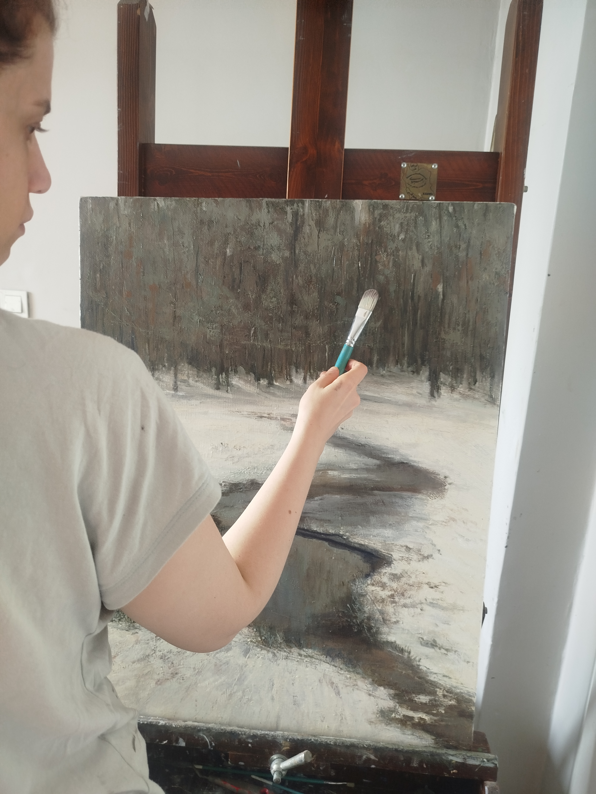
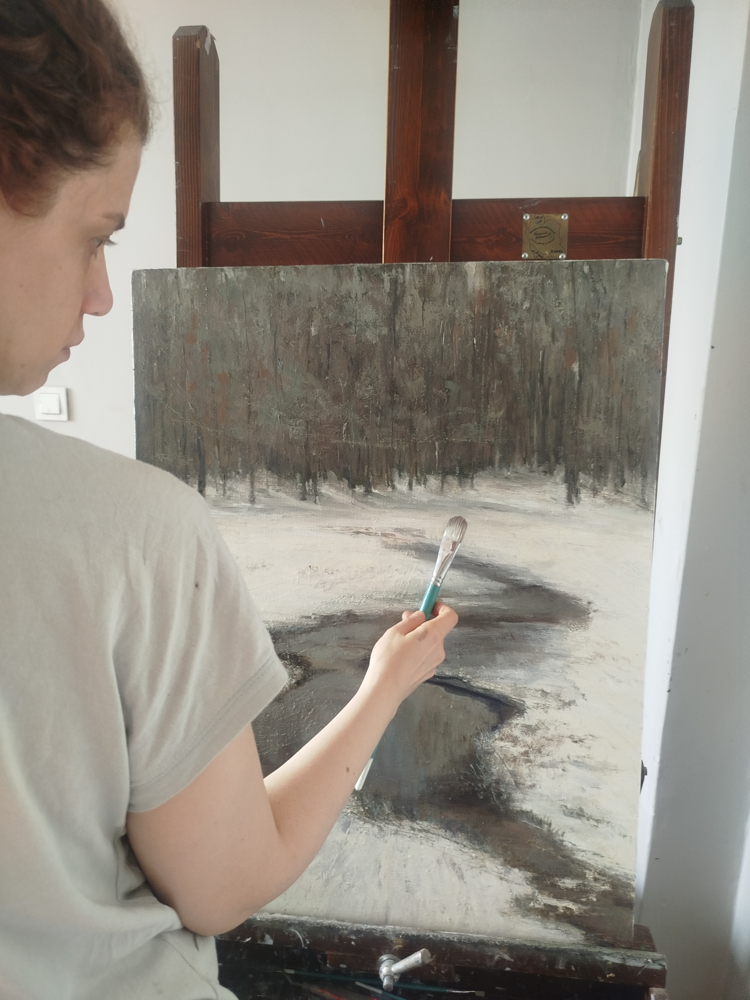
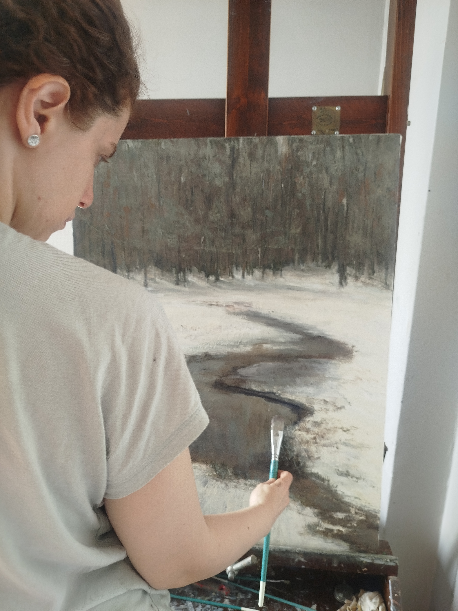
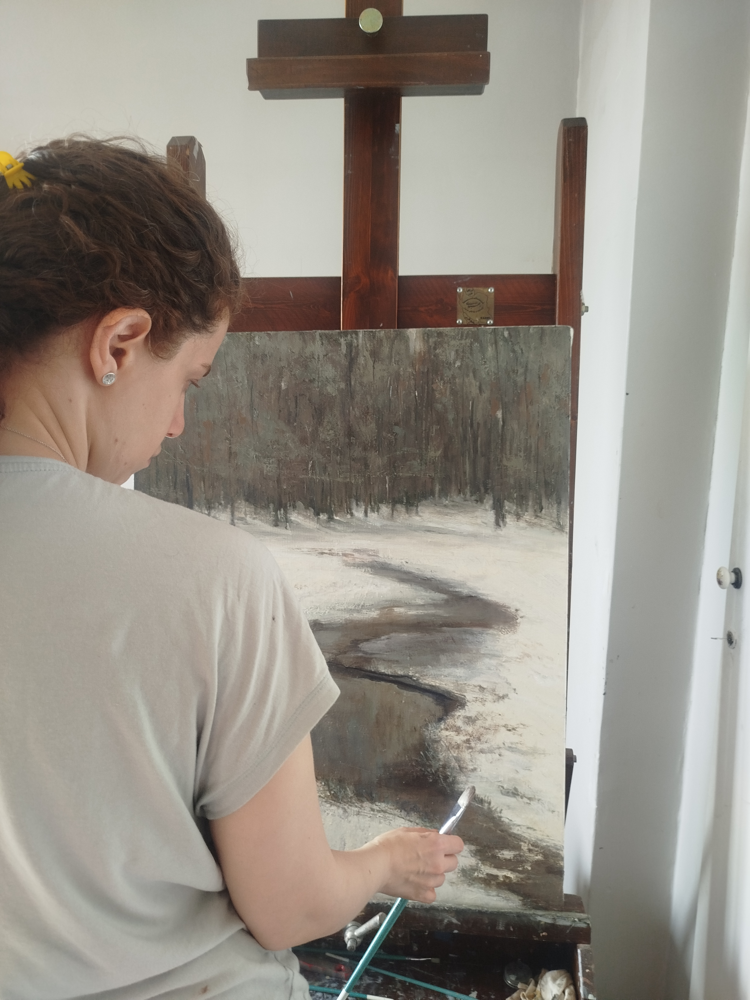
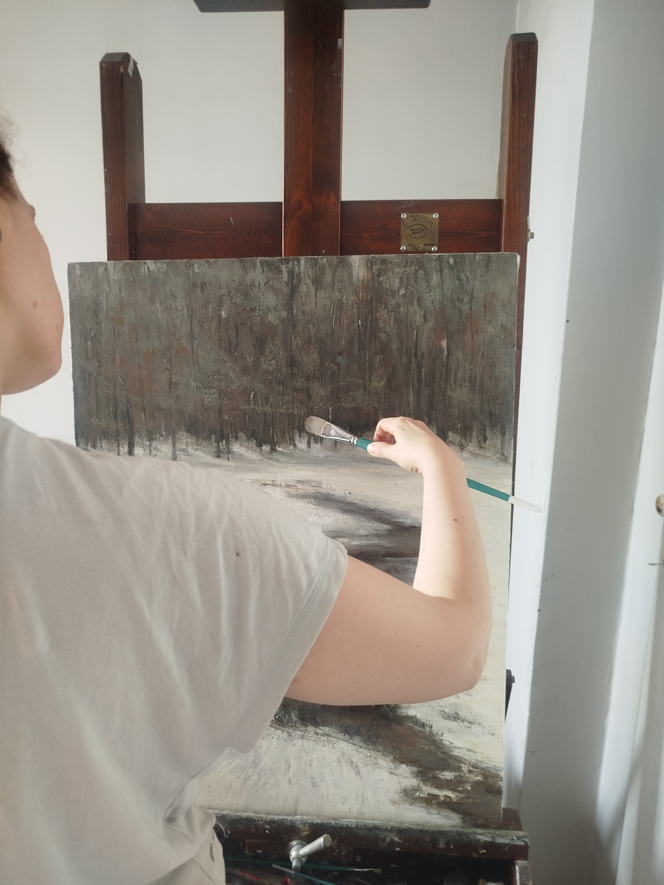

# Nasoodi.art — Wireframes and Interaction Design

**Status:** Proposed structural wireframes  
**Visual direction:** Quiet contemporary gallery; artwork-led

These are layout contracts, not final visual designs. Final spacing, typography, palette, and image sequence must be evaluated against Ghazaleh's actual paintings.

## 1. Global shell

### Desktop

```text
┌────────────────────────────────────────────────────────────────────┐
│ GHAZALEH NASOODI      WORKS   ABOUT   CV   CONTACT    فارسی | EN   │
├────────────────────────────────────────────────────────────────────┤
│                                                                    │
│                       PRIMARY ARTWORK                              │
│                  (large, accurate reproduction)                    │
│                                                                    │
│ GHAZALEH ABDOLAHZADE NASOODI                                       │
│ Oil Painter                                                        │
│                                                                    │
│ Explore selected works  →                                          │
├────────────────────────────────────────────────────────────────────┤
│ WORKS / SELECTED                                                   │
│                                                                    │
│ [Artwork image]       [Artwork image]       [Artwork image]         │
│ Title / year          Title / year          Title / year            │
├────────────────────────────────────────────────────────────────────┤
│ ABOUT EXCERPT                         [Portrait/studio, optional]   │
│ Artist-approved text                                               │
│ Read about the artist →                                            │
├────────────────────────────────────────────────────────────────────┤
│ CONTACT   Instagram   Language   ©                                 │
└────────────────────────────────────────────────────────────────────┘
```

The hero may use one strong painting or a carefully curated editorial composition. Do not turn the hero into a rotating carousel by default.

### Mobile

```text
┌──────────────────────────────┐
│ GHAZALEH NASOODI   MENU  FA/EN│
├──────────────────────────────┤
│                              │
│        PRIMARY ARTWORK       │
│                              │
│ GHAZALEH NASOODI             │
│ Oil Painter                  │
│ Explore works  →             │
├──────────────────────────────┤
│ SELECTED WORKS               │
│                              │
│ [Artwork image]              │
│ Title · year                 │
│                              │
│ [Artwork image]              │
│ Title · year                 │
├──────────────────────────────┤
│ ABOUT                        │
│ Short approved introduction  │
│ Read more →                  │
├──────────────────────────────┤
│ CONTACT · INSTAGRAM          │
└──────────────────────────────┘
```

On mobile, prioritize one-column artwork viewing and comfortable captions. Avoid tiny multi-column thumbnails that make paintings impossible to appreciate.

## 2. Works index

### Desktop

```text
┌────────────────────────────────────────────────────────────────────┐
│ HEADER                                                             │
├────────────────────────────────────────────────────────────────────┤
│ WORKS                                                              │
│ Optional short introduction                                        │
│                                                                    │
│ SERIES / COLLECTION (only if meaningful and approved)              │
│ [large landscape]       [portrait image]                            │
│ [portrait image]        [large landscape]                            │
│ [portrait image]        [portrait image]                             │
│                                                                    │
│ Artwork captions: title / year / medium (known fields only)        │
└────────────────────────────────────────────────────────────────────┘
```

Use a balanced editorial grid or masonry-like composition only if it preserves image dimensions and predictable reading order. CSS grid with explicit spans is acceptable; avoid JavaScript masonry if it adds layout instability.

### Mobile

- One column is the safest default for paintings.
- A two-column layout may be used only for small, visually coherent previews with sufficient image size.
- Keep captions directly associated with their artwork.
- Do not reorder the visual grid in a way that conflicts with DOM and keyboard reading order.

## 3. Artwork detail

```text
┌────────────────────────────────────────────────────────────────────┐
│ HEADER                                                             │
├────────────────────────────────────────────────────────────────────┤
│ ← Back to Works                                                    │
│                                                                    │
│                    LARGE ARTWORK IMAGE                             │
│                                                                    │
│                                                                    │
│ Title                                                              │
│ Year · Medium                                                      │
│ Dimensions                                                         │
│ Short artist-approved note                                         │
│ Availability (only if confirmed)                                   │
│ Enquire about this work → (only if enquiry is enabled)             │
│                                                                    │
│ [Optional detail image]                                            │
│ [Previous work]                                  [Next work]       │
└────────────────────────────────────────────────────────────────────┘
```

The detail image should be the focus. Metadata should be calm, readable, and consistent. Hide unknown fields rather than displaying “N/A” everywhere.

## 4. Lightbox (optional enhancement)

If a lightbox is implemented:

- Open only after an explicit user action.
- Provide visible close, previous, and next controls when applicable.
- Support Escape to close and restore focus to the invoking control.
- Keep keyboard focus within the modal while open.
- Expose the artwork title and useful image description to assistive technology.
- Prevent background scrolling without trapping users.
- Provide a close button with an accessible name and a sufficiently large touch target.
- Do not force zoom or prevent browser pinch zoom.
- Ensure the image fits within short-height screens and can be dismissed without scrolling.
- If there is only one image, do not show misleading previous/next controls.

A simple detail page without a lightbox is a valid first release.

## 5. About page

```text
┌────────────────────────────────────────────────────────────────────┐
│ HEADER                                                             │
├────────────────────────────────────────────────────────────────────┤
│ ABOUT THE ARTIST                                                   │
│                                                                    │
│ Artist portrait / studio image (optional)   BIOGRAPHY              │
│                                            Artist-approved facts   │
│                                                                    │
│ ARTIST STATEMENT                                                   │
│ First-person text describing the practice and concerns             │
│                                                                    │
│ Selected exhibitions / professional highlights (verified only)    │
└────────────────────────────────────────────────────────────────────┘
```

Keep statement and biography separate. The statement should describe the work; the biography should record factual professional context.

## 6. CV / exhibitions page

Use a simple chronological editorial list grouped by category. Include only categories with verified entries. If the artist has no formal exhibition history to publish yet, do not create a fake CV; the route can remain hidden until there is approved content.

## 7. Contact page

```text
┌────────────────────────────────────────────────────────────────────┐
│ HEADER                                                             │
├────────────────────────────────────────────────────────────────────┤
│ CONTACT                                                            │
│ A short artist-approved invitation                                 │
│                                                                    │
│ Email / approved contact method                                    │
│ Instagram @ghazalenasoodi                                          │
│                                                                    │
│ Optional enquiry form: name, email, subject, message              │
│ [Send enquiry]                                                     │
└────────────────────────────────────────────────────────────────────┘
```

Do not show a form until a real submission destination, validation, spam protection, and privacy notice exist. A mail link is a valid first-release option when the artist approves the address.

## 8. Persian RTL behavior

- Header order and navigation should read naturally from right to left.
- Use CSS logical properties for all layout spacing and positioning.
- Keep icons that indicate previous/next direction mirrored where semantically appropriate; do not mirror non-directional artwork or decorative marks.
- Use `dir="rtl"` at the page/document level for Persian, with `dir="ltr"` isolation for email, URLs, and Latin strings.
- Ensure gallery order and artwork captions follow a deliberate, consistent reading sequence.
- Do not simply right-align an English layout and call it RTL.

## 9. Responsive breakpoints

Test at representative widths, not only named device presets:

- Small mobile: 320–375 px.
- Large mobile: 390–430 px.
- Tablet portrait: 768 px.
- Tablet landscape / compact laptop: 1024 px.
- Desktop: 1280–1440 px.
- Wide desktop: 1600 px and above.
- Short-height desktop/mobile landscape: ensure the hero and lightbox remain usable.

The artwork should scale fluidly without cropping, horizontal overflow, or captions becoming detached from images.

## 10. Visual quality checks

Before approving the design:

- Compare displayed artwork against the supplied master image.
- Check warm/cool color shifts and dark shadow detail.
- Confirm image crop does not cut the canvas edges or signature.
- Check text and artwork contrast without placing text over important painted areas.
- Review both locales, all breakpoints, keyboard focus, and reduced-motion mode.
- Review loading placeholders and failed-image states.


## 11. Gallery index and gallery detail wireframes

### Gallery index — desktop

```text
┌───────────────────────────────────────────────────────────────────┐
│ GLOBAL SHELL / LEFT SIDEBAR                                       │
├───────────────────────────────────────────────────────────────────┤
│ GALLERIES                                                         │
│ Short approved introduction                                       │
│                                                                   │
│ ┌──────────────────────┐  ┌──────────────────────┐               │
│ │ [Gallery cover art]  │  │ [Gallery cover art]  │               │
│ │ Gallery title        │  │ Gallery title        │               │
│ │ Short description   │  │ Short description   │               │
│ │ Explore gallery →    │  │ Explore gallery →    │               │
│ └──────────────────────┘  └──────────────────────┘               │
│                                                                   │
│ [Additional gallery cards in curated order]                       │
└───────────────────────────────────────────────────────────────────┘
```

### Gallery index — mobile

```text
┌───────────────────────────────┐
│ GLOBAL MOBILE HEADER          │
├───────────────────────────────┤
│ GALLERIES                     │
│ Approved introduction         │
│                               │
│ [Full gallery cover image]    │
│ Gallery title                 │
│ Short description             │
│ Explore gallery →             │
│                               │
│ [Next gallery cover]          │
│ Gallery title                 │
│ Short description             │
│ Explore gallery →             │
└───────────────────────────────┘
```

### Gallery detail

```text
┌───────────────────────────────────────────────────────────────────┐
│ GLOBAL SHELL                                                      │
├───────────────────────────────────────────────────────────────────┤
│ ← All galleries                                                   │
│ Gallery title                                                     │
│ Short artist-approved description                                 │
│                                                                   │
│ [Artwork A]                 [Artwork B]                            │
│ Title / known metadata      Title / known metadata                │
│                                                                   │
│ [Artwork C — larger]        [Artwork D]                            │
│ Title / known metadata      Title / known metadata                │
│                                                                   │
│ [More artworks in curated order]                                  │
└───────────────────────────────────────────────────────────────────┘
```

Gallery cards navigate to dedicated gallery pages. Artwork cards navigate to individual artwork detail pages when available. Preserve curated DOM and keyboard order. Mobile defaults to a generous one-column layout.

## 12. Homepage hero and featured content wireframe

### Desktop

```text
┌───────────────────────────────────────────────────────────────────┐
│ GLOBAL SHELL                                                      │
├───────────────────────────────────────────────────────────────────┤
│ ┌─────────────────────────────┐  ARTIST NAME                      │
│ │                             │  Oil Painter                      │
│ │      APPROVED HERO           │  Short approved introduction     │
│ │      PAINTING IMAGE          │  Explore galleries →             │
│ │                             │  View selected works →            │
│ └─────────────────────────────┘                                   │
├───────────────────────────────────────────────────────────────────┤
│ FEATURED WORKS                                                    │
│ [Painting]           [Painting]           [Painting]               │
│ Title                Title                Title                    │
│ View all works →                                                │
├───────────────────────────────────────────────────────────────────┤
│ FEATURED GALLERIES                                                │
│ [Gallery cover + title + short description]                       │
│ [Gallery cover + title + short description]                       │
│ View all galleries →                                              │
├───────────────────────────────────────────────────────────────────┤
│ ABOUT PREVIEW · VERIFIED HIGHLIGHTS · CONTACT · FOOTER            │
└───────────────────────────────────────────────────────────────────┘
```

### Mobile

```text
┌───────────────────────────────┐
│ GLOBAL MOBILE HEADER          │
├───────────────────────────────┤
│ [Full hero painting]          │
│ Artist name · Oil Painter     │
│ Short approved intro          │
│ Explore galleries →           │
│ View selected works →         │
├───────────────────────────────┤
│ FEATURED WORKS                │
│ [Painting]                    │
│ Title / known metadata        │
│ [Painting]                    │
│ Title / known metadata        │
│ View all works →              │
├───────────────────────────────┤
│ FEATURED GALLERIES            │
│ [Gallery cover]               │
│ Title + short description     │
│ Explore gallery →             │
│ [Next gallery]                │
│ View all galleries →          │
├───────────────────────────────┤
│ ABOUT · CONTACT · FOOTER      │
└───────────────────────────────┘
```

Featured Works and Featured Galleries are distinct sections. The former promotes individual paintings; the latter promotes curated collections. Neither is an autoplay carousel.

## 13. Journal landing, homepage preview, and detail wireframes

The complete interaction and content contract is in [journal-and-events.md](./journal-and-events.md). These compact wireframes establish the page relationships.

### Homepage — Latest from the Journal

```text
LATEST FROM THE JOURNAL                         View all journal entries →
[Featured upcoming event — only when eligible]
[Event image]  Event or exhibition title
               Confirmed date · venue
               Short summary · View event →

[Recent entry]                         [Recent entry]
Title · type · publication date        Title · type · publication date
Excerpt · Read more                    Excerpt · Read more
```

The section follows Featured Works and Featured Galleries. If no upcoming event exists, show recent published entries; if no eligible entries exist, omit the section.

### Journal index

```text
JOURNAL
Artist-approved introduction
[All] [Exhibitions] [Events] [Studio Updates] [Stories]
[Featured upcoming event — optional]
[Entry cards in reverse chronological publication order]
[Pagination / Load more — only when needed]
```

### Journal detail

```text
← Journal
TYPE LABEL · TITLE · SUMMARY · PUBLICATION DATE
[Optional approved cover image]
[Article rich text OR event details panel and event content]
[Related artworks / galleries — optional]
[More from Journal]
```

Journal is a primary navigation destination on desktop and mobile. Persian and English use the same semantic order with locale-appropriate direction and labels.

## 14. Visual composition and interaction quality

All wireframes in this document are structural, not permission to implement generic card grids or placeholder imagery. Apply [design-direction-and-system-refinement.md](./design-direction-and-system-refinement.md) for the visual composition and [design-engineering-skills.md](./design-engineering-skills.md) for component states and motion.

For each wireframe:
- Establish one clear focal point and meaningful reading order.
- Use open editorial compositions and varied image/text proportions where appropriate; do not force all content into equal cards.
- Preserve artwork's natural ratio and full composition.
- Specify desktop, tablet, mobile, and short-height behavior, not only a desktop sketch.
- Include Persian RTL and English LTR, long titles, sparse content, and reduced-motion states.
- Use motion only when it communicates a state or spatial relationship; wireframes must remain understandable as static layouts.

---

# 15. Selected Works — three-level experience wireframes

The authoritative interaction and implementation contract is [Selected Works: Three-Level Experience](./selected-works-three-level-experience.md). These wireframes make the requested homepage → collection index → collection detail journey concrete. They are structural design references, not permission to publish candidate artwork or invent collection content.

**Image-reference rule:** the five images below are existing candidate samples from specification/assets/gallery/. They are embedded to help evaluate image scale, ratio, and editorial composition. Their identity, rights, title, collection membership, metadata, and artist approval remain unverified. Do not use them as public artwork records until the asset review and artist approval gates are complete.

## 15.1 Repository artwork samples for layout evaluation

The candidate images are intentionally shown at their natural proportions. The wireframe must not crop, recolor, mirror, filter, or otherwise alter them.

| Candidate sample | Repository asset | Wireframe use |
|---|---|---|
|  | assets/gallery/1.jpg | Homepage card / viewer scale check |
|  | assets/gallery/2.jpg | Portrait/landscape ratio check |
|  | assets/gallery/3.jpg | Collection cover preview |
|  | assets/gallery/4.jpg | Collection gallery rhythm |
|  | assets/gallery/5.jpg | Mixed-image sequence and viewer navigation |

The sample table is a visual reference only. Do not infer that these five files form one collection or assign them titles based on appearance.

## 15.2 Level 1 — Homepage Selected Works (desktop)

~~~text
┌──────────────────────────────────────────────────────────────────────────────┐
│ GLOBAL SHELL / ARTIST WORDMARK / WORKS / JOURNAL / ABOUT / LOCALE            │
├──────────────────────────────────────────────────────────────────────────────┤
│ SELECTED WORKS                                      Explore all works  →     │
│ [Optional approved introductory sentence]                                   │
│                                                                              │
│ ┌──────────────────────────────────────────┐  ┌──────────────────────────┐  │
│ │                                          │  │                          │  │
│ │          ARTWORK 1                       │  │    ARTWORK 2             │  │
│ │          native aspect ratio             │  │    native aspect ratio   │  │
│ │                                          │  │                          │  │
│ └──────────────────────────────────────────┘  └──────────────────────────┘  │
│ Approved artwork title · optional year          Approved artwork title      │
│                                                                              │
│ ┌──────────────────────────┐  ┌──────────────────────────────────────────┐  │
│ │                          │  │                                          │  │
│ │    ARTWORK 3             │  │          ARTWORK 4                       │  │
│ │                          │  │          native aspect ratio             │  │
│ └──────────────────────────┘  └──────────────────────────────────────────┘  │
│ Approved title                Approved title · optional verified metadata   │
└──────────────────────────────────────────────────────────────────────────────┘
~~~

- The example uses varied spans to show editorial rhythm, not fixed required positions.
- Actual grid spans respond to real source image ratios and curated order.
- Each card has a visible title/caption and a single accessible activation target.
- Explore all works is a normal route link to the collection index, not a modal.
- Do not display sample file names, sample numbers, or invented titles to visitors.

## 15.3 Level 1 — Homepage Selected Works (tablet)

~~~text
┌──────────────────────────────────────────────────────────────┐
│ GLOBAL TABLET SHELL                                          │
├──────────────────────────────────────────────────────────────┤
│ SELECTED WORKS                    Explore all works  →       │
│ [Approved introduction]                                      │
│                                                              │
│ ┌─────────────────────────────┐ ┌──────────────────────────┐ │
│ │       ARTWORK 1             │ │       ARTWORK 2           │ │
│ └─────────────────────────────┘ └──────────────────────────┘ │
│ Title / known metadata          Title / known metadata       │
│                                                              │
│ ┌──────────────────────────────────────────────────────────┐ │
│ │                    ARTWORK 3                              │ │
│ └──────────────────────────────────────────────────────────┘ │
│ Title / known metadata                                       │
└──────────────────────────────────────────────────────────────┘
~~~

Use two columns only while images and captions remain comfortable. A feature image may span the content width. Do not reduce captions to tiny overlays to preserve a two-column layout.

## 15.4 Level 1 — Homepage Selected Works (mobile)

~~~text
┌────────────────────────────────┐
│ MOBILE GLOBAL HEADER / MENU    │
├────────────────────────────────┤
│ SELECTED WORKS                 │
│ Approved short introduction    │
│                                │
│ ┌────────────────────────────┐ │
│ │       ARTWORK 1            │ │
│ │       full composition     │ │
│ └────────────────────────────┘ │
│ Approved title · optional year │
│                                │
│ ┌────────────────────────────┐ │
│ │       ARTWORK 2            │ │
│ │       full composition     │ │
│ └────────────────────────────┘ │
│ Approved title                 │
│                                │
│ Explore all works  →           │
└────────────────────────────────┘
~~~

One column is the default. Use native image ratios; titles are visible without hover. Keep Explore all works clearly available.

## 15.5 Level 1 — Artwork Viewer (desktop)

~~~text
┌──────────────────────────────────────────────────────────────────────────────┐
│ SELECTED WORKS                                      03 / 06           [ X ]  │
├──────────────────────────────────────────────────────────────────────────────┤
│                                                                              │
│  [ PREVIOUS ]     ┌────────────────────────────────┐     [ NEXT ]            │
│                   │                                │                         │
│                   │        FULL ARTWORK IMAGE      │                         │
│                   │        object-fit: contain     │                         │
│                   │                                │                         │
│                   └────────────────────────────────┘                         │
│                                       ┌────────────────────────────────────┐ │
│                                       │ APPROVED ARTWORK TITLE             │ │
│                                       │ Year · Medium · Dimensions         │ │
│                                       │                                    │ │
│                                       │ Artist-approved description       │ │
│                                       │                                    │ │
│                                       │ Collection: optional approved link│ │
│                                       └────────────────────────────────────┘ │
└──────────────────────────────────────────────────────────────────────────────┘
~~~

The image and information form one Dialog composition. Title and description are visible beside the image at desktop widths. Unknown metadata is omitted. A long description may scroll independently without shrinking the painting excessively.

## 15.6 Level 1 — Artwork Viewer (tablet)

~~~text
┌────────────────────────────────────────────────────────────┐
│ SELECTED WORKS                                  03 / 06 [X] │
├────────────────────────────────────────────────────────────┤
│                                                            │
│ [PREV]        ┌──────────────────────────┐        [NEXT]   │
│               │                          │                 │
│               │      FULL ARTWORK        │                 │
│               │      CONTAIN             │                 │
│               │                          │                 │
│               └──────────────────────────┘                 │
│                                                            │
│ APPROVED ARTWORK TITLE                                     │
│ Verified metadata                                          │
│ Artist-approved description                                │
└────────────────────────────────────────────────────────────┘
~~~

Prefer a vertically stacked image and information layout once a side column would make the image too small. Keep navigation and Close visible and reachable.

## 15.7 Level 1 — Artwork Viewer (mobile)

~~~text
┌────────────────────────────────┐
│ SELECTED WORKS       03 / 06 [X]│
├────────────────────────────────┤
│ ┌────────────────────────────┐ │
│ │       FULL ARTWORK         │ │
│ │       CONTAIN              │ │
│ └────────────────────────────┘ │
│                                │
│ [ ← Previous ] [ Next → ]      │
│                                │
│ APPROVED ARTWORK TITLE         │
│ Verified year / medium / size │
│                                │
│ Artist-approved description   │
│ may continue below the fold   │
└────────────────────────────────┘
~~~

Use a near/full-screen Dialog with safe-area padding. The title is immediately below the image; it must not be hidden in a separate drawer. Content scrolls naturally for long descriptions. Swipe may supplement, never replace, visible navigation buttons. On short-height mobile landscape, allow vertical scrolling and keep Close reachable.

## 15.8 Level 2 — Works / collection index (desktop)

~~~text
┌──────────────────────────────────────────────────────────────────────────────┐
│ GLOBAL SHELL / LEFT SIDEBAR                                                  │
├──────────────────────────────────────────────────────────────────────────────┤
│ WORKS / COLLECTIONS                                                          │
│ Approved introductory sentence                                               │
│                                                                              │
│ ┌────────────────────────────────────────┐  ┌─────────────────────────────┐ │
│ │                                        │  │                             │ │
│ │         COLLECTION COVER A             │  │      COLLECTION COVER B     │ │
│ │         full artwork / approved crop   │  │      full artwork           │ │
│ └────────────────────────────────────────┘  └─────────────────────────────┘ │
│ COLLECTION TITLE A                         COLLECTION TITLE B                │
│ Approved short description                 Approved short description        │
│ Optional valid count                       Explore collection →              │
│ Explore collection →                                                         │
│                                                                              │
│ ┌────────────────────────────────────────────────────────────────────────┐  │
│ │                         COLLECTION COVER C                             │  │
│ └────────────────────────────────────────────────────────────────────────┘  │
│ COLLECTION TITLE C · approved description · Explore collection →            │
└──────────────────────────────────────────────────────────────────────────────┘
~~~

Each collection is a destination, not a modal. Use one coherent link per card; do not nest separate links. The cover must belong to the collection. Counts derive from published membership only. A featured wide collection is optional, not mandatory.

## 15.9 Level 2 — Works / collection index (tablet)

~~~text
┌──────────────────────────────────────────────────────────────┐
│ GLOBAL TABLET SHELL                                          │
├──────────────────────────────────────────────────────────────┤
│ WORKS / COLLECTIONS                                          │
│ Approved introduction                                        │
│                                                              │
│ ┌─────────────────────────────┐ ┌──────────────────────────┐ │
│ │ COLLECTION COVER A          │ │ COLLECTION COVER B       │ │
│ └─────────────────────────────┘ └──────────────────────────┘ │
│ Title + description             Title + description         │
│ Explore collection →            Explore collection →        │
│                                                              │
│ ┌──────────────────────────────────────────────────────────┐ │
│ │ COLLECTION COVER C                                        │ │
│ └──────────────────────────────────────────────────────────┘ │
│ Title + description · Explore collection →                  │
└──────────────────────────────────────────────────────────────┘
~~~

## 15.10 Level 2 — Works / collection index (mobile)

~~~text
┌────────────────────────────────┐
│ MOBILE GLOBAL HEADER           │
├────────────────────────────────┤
│ WORKS / COLLECTIONS            │
│ Approved introduction          │
│                                │
│ ┌────────────────────────────┐ │
│ │ COLLECTION COVER A         │ │
│ │ full image                 │ │
│ └────────────────────────────┘ │
│ COLLECTION TITLE A             │
│ Approved short description     │
│ Optional valid artwork count   │
│ Explore collection →           │
│                                │
│ ┌────────────────────────────┐ │
│ │ COLLECTION COVER B         │ │
│ └────────────────────────────┘ │
│ COLLECTION TITLE B             │
│ Approved short description     │
│ Explore collection →           │
└────────────────────────────────┘
~~~

One collection per row is the default. Do not put long descriptions in image overlays. Keep title and Explore action visible without hover.

## 15.11 Level 3 — Collection detail (desktop)

~~~text
┌──────────────────────────────────────────────────────────────────────────────┐
│ GLOBAL SHELL                                                                  │
├──────────────────────────────────────────────────────────────────────────────┤
│ ← ALL WORKS / COLLECTIONS                                                     │
│                                                                              │
│ COLLECTION TITLE                                                             │
│ Artist-approved collection description                                      │
│ Optional verified year range · valid artwork count                          │
│                                                                              │
│ ┌────────────────────────────────────────────────────────────────────────┐  │
│ │ OPTIONAL FEATURED COLLECTION ARTWORK (only if it adds value)            │  │
│ └────────────────────────────────────────────────────────────────────────┘  │
│                                                                              │
│ THE COLLECTION                                                               │
│ ┌──────────────────────────────┐   ┌─────────────────────────────────────┐ │
│ │ ARTWORK A                    │   │ ARTWORK B                           │ │
│ └──────────────────────────────┘   └─────────────────────────────────────┘ │
│ Approved title                       Approved title                         │
│ ┌─────────────────────────────────────┐  ┌───────────────────────────────┐  │
│ │ ARTWORK C                           │  │ ARTWORK D                     │  │
│ └─────────────────────────────────────┘  └───────────────────────────────┘  │
│ Approved title                          Approved title                      │
│                                                                              │
│ ← PREVIOUS COLLECTION       ALL COLLECTIONS       NEXT COLLECTION →         │
└──────────────────────────────────────────────────────────────────────────────┘
~~~

Show every published artwork in the configured order. Do not repeat the optional featured image as the first grid item unless the editorial composition explicitly calls for it. Viewer navigation follows the collection list.

## 15.12 Level 3 — Collection detail (tablet)

~~~text
┌──────────────────────────────────────────────────────────────┐
│ GLOBAL TABLET SHELL                                          │
├──────────────────────────────────────────────────────────────┤
│ ← ALL COLLECTIONS                                             │
│ COLLECTION TITLE                                              │
│ Approved description · optional verified metadata            │
│                                                              │
│ [OPTIONAL FEATURED ARTWORK]                                   │
│                                                              │
│ ┌─────────────────────────────┐ ┌──────────────────────────┐ │
│ │ ARTWORK A                   │ │ ARTWORK B                │ │
│ └─────────────────────────────┘ └──────────────────────────┘ │
│ Title                          Title                         │
│ ┌─────────────────────────────┐ ┌──────────────────────────┐ │
│ │ ARTWORK C                   │ │ ARTWORK D                │ │
│ └─────────────────────────────┘ └──────────────────────────┘ │
│ Title                          Title                         │
│ ← Previous collection     All collections    Next collection →│
└──────────────────────────────────────────────────────────────┘
~~~

## 15.13 Level 3 — Collection detail (mobile)

~~~text
┌────────────────────────────────┐
│ MOBILE GLOBAL HEADER           │
├────────────────────────────────┤
│ ← ALL COLLECTIONS              │
│ COLLECTION TITLE               │
│ Approved description           │
│ Optional verified year/count   │
│                                │
│ ┌────────────────────────────┐ │
│ │ OPTIONAL FEATURED IMAGE    │ │
│ └────────────────────────────┘ │
│                                │
│ ┌────────────────────────────┐ │
│ │ ARTWORK A                  │ │
│ └────────────────────────────┘ │
│ Approved title                 │
│                                │
│ ┌────────────────────────────┐ │
│ │ ARTWORK B                  │ │
│ └────────────────────────────┘ │
│ Approved title                 │
│                                │
│ [Further works in curated order]│
│ Previous / All / Next          │
└────────────────────────────────┘
~~~

One-column gallery is the default. Keep the collection intro concise and near the top. Avoid a very tall hero. Preserve image ratios and readable captions.

## 15.14 Short-height and landscape behavior

For short-height desktop and mobile landscape:
- The viewer must not use a fixed height that clips its close button, artwork title, or description.
- Constrain the image to available viewport height using contain; allow the viewer content region to scroll.
- Keep Close visible and reachable.
- On desktop, the information column may scroll independently if needed.
- On mobile, prefer one natural vertical scroll container.
- Do not hide description/title merely to force the image to fit.
- Verify at 320×568, 390×667, 667×375, 1024×600, and 1280×720 in addition to standard viewports.

## 15.15 State and transition map

~~~text
HOME
 ├─ Select artwork ───────────────> HOME ARTWORK VIEWER
 │                                  ├─ Previous / Next: homepage selection only
 │                                  ├─ Close / Escape / Back: HOME, same scroll
 │                                  └─ Share/direct route: canonical artwork page
 │
 └─ Explore Works ────────────────> COLLECTION INDEX
                                    ├─ Select collection ─> COLLECTION DETAIL
                                    │                        ├─ Select artwork
                                    │                        │   └─ COLLECTION ARTWORK VIEWER
                                    │                        │       ├─ Previous / Next:
                                    │                        │       │  current collection only
                                    │                        │       └─ Close / Back:
                                    │                        │          same card and scroll
                                    │                        ├─ Previous / Next collection
                                    │                        └─ All collections
                                    └─ Browser Back ────────> HOME
~~~

All wireframes must be reviewed in Persian RTL and English LTR. Preserve the same semantic order, artwork fidelity, and responsive behavior in both locales.


## 16. Responsive artwork carousel and Journal preview wireframes — 2026-10-31

The new cross-page layout contract is [artwork-discovery-carousel-and-editorial-experience.md](./artwork-discovery-carousel-and-editorial-experience.md). These structural wireframes supersede earlier grid-first Selected Works and collection-detail layouts where they conflict. The homepage Hero remains static. Artwork imagery must come from the approved canonical inventory.

### 16.1 Homepage — desktop

```text
┌────────────────────────────────────────────────────────────────────────────┐
│ PERSISTENT LEFT SIDEBAR │                 ARTIST / NAV                      │
├─────────────────────────┴──────────────────────────────────────────────────┤
│                    STATIC APPROVED ARTWORK HERO                            │
│                  Artist identity / approved introduction                   │
├────────────────────────────────────────────────────────────────────────────┤
│ SELECTED WORKS                                      [‹]             [›]    │
│  [ LARGE ARTWORK A ]    [ LARGE ARTWORK B ]    [ LARGE ARTWORK C ]          │
│  Approved title        Approved title         Approved title               │
│  (carousel rail; 3 substantial items at this width)                        │
├────────────────────────────────────────────────────────────────────────────┤
│ FEATURED COLLECTIONS                                                       │
│ [Collection cover + title + description]  [Collection cover + details]     │
│                                      View all galleries →                  │
├────────────────────────────────────────────────────────────────────────────┤
│ JOURNAL                                                                    │
│ [Latest published entry]                   [Second latest entry]          │
│ title / date / excerpt                    title / date / excerpt           │
│                                      Explore Journal →                     │
└────────────────────────────────────────────────────────────────────────────┘
```

### 16.2 Homepage — tablet

```text
┌──────────────────────────────────────────────────────────────┐
│ NAV / ARTIST                                                  │
│ STATIC ARTWORK HERO                                           │
├──────────────────────────────────────────────────────────────┤
│ SELECTED WORKS                                  [‹]     [›]   │
│ [ ARTWORK A ]                  [ ARTWORK B ]                  │
│ title/caption                  title/caption                  │
├──────────────────────────────────────────────────────────────┤
│ FEATURED COLLECTIONS                                          │
│ [Collection preview]          [Collection preview]            │
├──────────────────────────────────────────────────────────────┤
│ JOURNAL                                                       │
│ [Latest post]                 [Second latest post]             │
│ Explore Journal →                                             │
└──────────────────────────────────────────────────────────────┘
```

### 16.3 Homepage — mobile

```text
┌──────────────────────────────┐
│ MOBILE NAV / ARTIST          │
│ STATIC ARTWORK HERO          │
├──────────────────────────────┤
│ SELECTED WORKS        [‹] [›] │
│ ┌──────────────────────────┐ │
│ │      ARTWORK A           │ │
│ └──────────────────────────┘ │
│ Approved title               │
│       next item peek →       │
├──────────────────────────────┤
│ FEATURED COLLECTIONS         │
│ [Collection cover]           │
│ Title / short description    │
│ Explore collection →         │
├──────────────────────────────┤
│ JOURNAL                      │
│ [Latest entry]               │
│ Title / date / excerpt       │
│ [Second latest entry]        │
│ Title / date / excerpt       │
│ Explore Journal →            │
└──────────────────────────────┘
```

### 16.4 Gallery index — responsive collection discovery

Desktop/tablet show two or more substantial collection previews according to available width; mobile shows one prominent collection preview with an optional next-preview cue. Each preview includes an approved cover, localized title, concise description, and one coherent Explore Collection link. Avoid tiny thumbnails and nested links.

### 16.5 Collection detail — desktop/tablet

```text
┌────────────────────────────────────────────────────────────────────────────┐
│ BREADCRUMB / COLLECTION TITLE                                               │
│ Approved collection introduction                                           │
├────────────────────────────────────────────────────────────────────────────┤
│ COLLECTION WORKS                                      [‹]          [›]      │
│ [ LARGE ARTWORK A ]       [ LARGE ARTWORK B ]       [ LARGE ARTWORK C ]     │
│ title / verified data    title / verified data    title / verified data   │
│ Position / total (only if useful)              View all works →            │
├────────────────────────────────────────────────────────────────────────────┤
│ ORDERED COMPLETE-COLLECTION INDEX (only when needed)                       │
│ 01  thumbnail + approved title                                             │
│ 02  thumbnail + approved title                                             │
│ 03  thumbnail + approved title                                             │
└────────────────────────────────────────────────────────────────────────────┘
```

### 16.6 Collection detail — mobile

```text
┌──────────────────────────────┐
│ COLLECTION TITLE             │
│ Approved introduction        │
├──────────────────────────────┤
│ COLLECTION WORKS      [‹] [›]│
│ ┌──────────────────────────┐ │
│ │      ARTWORK A           │ │
│ └──────────────────────────┘ │
│ Approved title               │
│ next artwork peek →          │
│ Position / total             │
│ View all works →             │
├──────────────────────────────┤
│ ORDERED WORKS INDEX          │
│ Thumbnail + title            │
│ Thumbnail + title            │
└──────────────────────────────┘
```

### 16.7 Journal — homepage, index, and detail

Homepage: two editorial post previews only, ordered by publication date, followed by Explore Journal. The previews retain their current image/title/date/excerpt post hierarchy and are not placed in an artwork carousel.

Journal index: preserve the existing chronological editorial archive and filters. Journal detail: preserve the existing title/date/body/event-facts hierarchy and readable text measure. Use approved images only; when no cover exists, use the specified typographic treatment.

### 16.8 Responsive and RTL annotations

- Desktop targets approximately 3 substantial artwork items in the main content container; wide desktop may fit 4 only when each remains legible.
- Tablet targets approximately 2 items.
- Mobile targets 1–1.2 items; a next-item peek is optional and must not clip artwork, captions, focus, or touch targets.
- These are content-width targets, not fixed breakpoints. Validate with the persistent sidebar and at intermediate widths.
- In Persian, carousel visual direction and control icons follow RTL; content order and artwork imagery are not mirrored.
- No wireframe implies autoplay or automatic movement.
